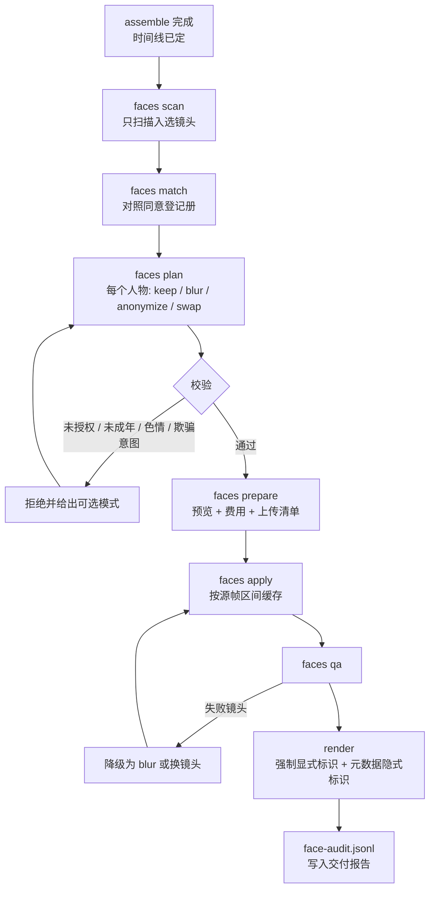

# jev-remix-cutter 增补设计：授权换脸 / 匿名化模块 + 原创度模块（替代“消重”）

> 归档设计资料：此文包含未实现的规划与当时的执行建议，不是当前 Skill 操作指令；实际能力和时长上限以 [SKILL.md](../SKILL.md) 与 [coverage.md](coverage.md) 为准。公开版已移除私人调研文档标识。
> **本增补做两件事。**
>
> 1. **AI 换脸加进来**，作为新模块 `face`，排在 M9。它支持三种模式：打码、匿名化（把人脸换成一张不存在的合成人脸）、授权换脸。授权换脸只在两方都有书面单独同意时可用：被换掉脸的人，和被换上去的脸的主人。用到合成人脸的成片，强制加显式标识和元数据隐式标识，CLI 不提供关闭开关。
>
> 2. **“消重”不做，用原创度模块 **<strong>`originality`</strong>** 代替**。消重类技巧（镜像、抽帧、变速、改 MD5、批量打乱）的用途，是让未经授权的搬运内容绕过平台的版权和查重识别，这部分我不提供设计。它要达到的正当目标是“作品不被判成搬运”，这个目标由原创度模块来完成：量化作品里有多少真正的新贡献，指出哪里最像搬运，并给出能直接执行的改法。这个模块放进 v1（M6）。
>
> 主方案见 [jev-remix-cutter Skill 详细设计方案](design.md)，本文第 5 节列出对主方案的全部改动，已同步写入主方案。

---

## 0. 处理原则

### 0.1 换脸为什么必须做成“双方授权 + 强制标识”

这不是额外加的限制，法规本身就是这么要求的：

- 《互联网信息服务深度合成管理规定》（2023 年 1 月 10 日起施行）**第十四条**：提供人脸、人声等生物识别信息编辑功能的，应当提示使用者依法告知**被编辑的个人**，并取得其**单独同意**。**第十七条**：人脸生成、人脸替换、人脸操控、姿态操控等服务，可能导致公众混淆或误认的，应当在合理位置、区域进行**显著标识**。**第十八条**：任何组织和个人不得采用技术手段删除、篡改、隐匿这些标识[citation](https://weibo.com/ttarticle/p/show?id=2309404877789906993365) [citation](https://www.chinaz.com/2022/1212/1477793.shtml)。

- 《民法典》第一千零一十九条：不得利用信息技术手段伪造等方式侵害他人肖像权[citation](https://www.sohu.com/a/1063500323_122937817/)。

- 2026 年 4 月，中广联演员委员会声明：未经演员本人书面授权，使用其肖像、声纹做 AI 换脸、仿声或二创改编，无论是否标注“非商用”，都构成侵权[citation](https://post.m.smzdm.com/p/a5r79d3k/)。

所以要说清楚一件事：最常见的需求是“把电影里的演员换成别人”或“把自己的脸换进电影名场面”。这时演员就是“被编辑的个人”，没有演员本人的书面授权，引擎会拒绝换脸。这种情况可以用的是打码，或者换成不存在的合成人脸。

### 0.2 “消重”为什么不做，以及用什么代替

消重的定义就是“让平台认不出这是别人的内容”。它的作用对象是版权方的识别系统，而不是观众。2026 年的平台规则解读也认为，只做裁剪、变速、镜像、滤镜、换 BGM，没有改变叙事结构、没有新增观点的，仍按搬运处理[citation](https://www.cnblogs.com/GEO-AI-20260729/p/22415708)。

原创度模块走反方向：不去降低和原片的相似度，而是增加作品自己的东西，比如旁白、观点、结构重组、自拍素材、分析图文；同时把最像“切条搬运”的片段指出来，让人改掉。

---

## 1. 模块总览

| 模块 | 解决什么 | 里程碑 | 新命令 |
| --- | --- | --- | --- |
| `originality` | 量化作品的转化程度，指出搬运风险点，给出可执行的改法；管理授权片单 | **M6（v1）** | `remix originality`、`remix license-catalog` |
| `face` | 打码、匿名化、授权换脸，以及同意登记、强制标识、审计日志 | **M9**（M9a / M9b / M9c 三步） | `remix consent`、`remix faces scan / match / plan / prepare / apply / qa` |

---

## 2. 原创度模块（`originality`,M6）

### 2.1 指标

全部由 `timeline.json`、`sources.json` 和意图卡确定性计算，不调用任何模型，不花钱。

| 指标 | 定义 | 计算方式 | 默认提示阈值（建议值） |
| --- | --- | --- | --- |
| `contribution_ratio` 新贡献覆盖率 | 成片里至少有一层“新贡献”的时长占比 | 新贡献层包括：用户自有素材（`license = own` 且标记为自拍）、用户撰写的旁白（旁白模式）、Agent 与用户共同撰写的观点字幕或分析图文、原创配乐或授权配乐替换了原声 | 低于 60% 提示 |
| `longest_raw_run_s` 最长原样连续段 | 成片中连续来自同一来源、保持原顺序、原速度、原声的最长时长 | 遍历相邻条目，合并满足“同源、源时间相接（间隔 \< 0.5 秒）、速度为 1、使用原声”的片段 | 超过 8 秒提示 |
| `order_preservation` 原序保持率 | 同源相邻条目里，仍按原片顺序紧挨着的比例 | 同源相邻对中，源时间递增且间隔 \< 2 秒的对数 ÷ 同源相邻对总数 | 高于 70% 提示 |
| `source_audio_ratio` 原声占比 | 原片音轨不经改动直接播放的时长占比 | 按音频轨道条目统计 | 高于 50% 提示 |
| `max_source_share` 单一来源占比 | 来自同一来源的时长占比的最大值 | 按来源聚合 | 高于 80% 提示 |
| `restructure` 结构重组 | 叙事结构是否不同于原片 | 意图卡有新主题且不是“剧情速看”；或使用旁白模式；或镜头顺序与原片顺序的 Kendall τ 低于 0.5 | 三项都不满足时提示 |
| `license_coverage` 授权覆盖率 | 来自 `own` / `licensed` 来源的时长占比 | 按来源授权聚合 | 低于 100% 时列出未授权部分 |
| `catalog_violations` 授权片单越界 | 使用了授权片单里的作品，但超出其使用条件（如单部最长使用时长） | 对照 `licenses/catalog.json` | 任何越界都报错 |

**阈值都是建议值，不代表任何平台的真实规则。** 平台规则会变，也不公开具体算法。阈值放在用户可以编辑的平台档案 `packs/platform-profiles/*.toml` 里。报告措辞固定为“提示 / 风险较高 / 越界”，不写“通过平台审核”之类的保证。

### 2.2 从指标到改法

每条提示都附带一个能直接执行的命令，Agent 和用户选择后就能改：

| 触发 | 建议 | 对应操作 |
| --- | --- | --- |
| `contribution_ratio` 偏低 | 加旁白讲你的观点；加分析字幕或图文卡；插入自拍素材 | `remix slots --mode narration`；`type: impact_text / title_card`；`remix ingest --license own` 后重新 `cast` |
| `longest_raw_run_s` 超标 | 把这一段拆开重组，或在中间插入反应、对比、分析镜头 | `remix explain --slot` 定位；`remix configure` 调整该段密度后重新 `slots`、`cast` |
| `order_preservation` 偏高 | 打破原片顺序，按主题或情绪重新组织 | 意图卡改为主题驱动；赛道包关闭 `chronological` |
| `source_audio_ratio` 偏高 | 用授权配乐或旁白替换大部分原声，只保留关键台词 | `sound`：原声只保留台词钩子，其他段落静音原声 |
| `max_source_share` 偏高 | 引入更多来源或自有素材 | 补充素材后重新 `cast` |
| `restructure` 不满足 | 重写意图卡：给出你自己的主题和观点 | Agent 与用户重写 `intent.json` |
| `catalog_violations` | 缩短该作品的使用时长，或换素材 | 在 `thresholds.toml` 中为该来源设使用上限后重新 `cast` |

### 2.3 授权片单（`licenses/catalog.json`）

一些平台会公布允许二创的作品清单和使用条件。引擎不内置任何平台的片单，由用户按平台公布的实际条款填写：

```json
{
  "catalog_id": "douyin-authorized-2026-10",
  "source_note": "用户按平台公布条款填写，引擎不校验条款真实性",
  "titles": [
    {"title": "<作品名>", "match": {"source_ids": ["src01", "src02"]},
     "constraints": {"max_seconds_total": 180, "allowed_formats": ["commentary", "remix"], "expires": "2026-12-31"}}
  ]
}
```

`remix license-catalog --import catalog.json --map src01=<作品名>` 把来源和片单条目关联起来，被关联的来源授权状态记为 `licensed`，并附带约束。`cast` 会遵守 `max_seconds_total`，`render` 前会再检查一次。

### 2.4 输出与位置

- `remix originality --run "$RUN"` 生成 `originality.json` 和审片页上的“原创度”面板，每个提示都能点击跳到时间线上对应的位置。

- 工作流位置：`assemble` 之后、正式 `render` 之前。正式渲染不会被提示拦住（只有授权片单越界会拦），但交付报告必须附上原创度结果。

```json
{
  "profile": "default",
  "metrics": {
    "contribution_ratio": 0.42, "longest_raw_run_s": 11.3, "order_preservation": 0.81,
    "source_audio_ratio": 0.55, "max_source_share": 0.64, "restructure": false,
    "license_coverage": 1.0, "catalog_violations": []
  },
  "findings": [
    {"metric": "longest_raw_run_s", "level": "warn", "where": {"start_f": 420, "end_f": 759},
     "suggest": "把这一段拆开重组，或插入反应 / 对比 / 分析镜头", "action": "remix explain --slot build.03"}
  ]
}
```

### 2.5 明确不实现

镜像翻转、为规避识别而做的裁切缩放、变速或抽帧、修改文件哈希、调整感知哈希距离、添加干扰噪声或边框、批量随机打乱生成近似重复视频、为矩阵账号批量生产同质内容。`variants` 命令只用于 A/B 测试不同钩子、音乐或节奏，单次默认上限 10 个，交付报告注明“变体用于测试”。

### 2.6 测试

用合成时间线构造已知答案：一段 12 秒原样连续片段、一段原序保持的对白、一段旁白覆盖的区间，逐项断言八个指标的值；平台档案阈值修改后报告级别随之变化；授权片单越界时 `render` 退出码为 4。

---

## 3. 授权换脸 / 匿名化模块（`face`,M9）

### 3.1 三种模式

| 模式 | 做什么 | 被处理的人需要什么 | 换上去的脸需要什么 | 是否需要 AI 标识 |
| --- | --- | --- | --- | --- |
| `blur` 打码 | 高斯模糊或马赛克 | 不需要 | — | 不需要（不属于深度合成），交付报告记录 |
| `anonymize` 匿名化 | 换成一张**不存在的**合成人脸，同一人物在全片保持同一张合成脸 | 不需要（目的是去除可识别性） | 必须是合成人脸，并经过“不像任何已登记的人、不像本片中任何人”的检查 | **需要** |
| `swap` 授权换脸 | 换成一位已授权的真实人物的脸 | **必须**在同意登记册中，角色含 `subject`，授权范围覆盖本次用途 | **必须**在同意登记册中，角色含 `target`，授权范围覆盖本次用途 | **需要** |

`keep` 表示不处理，是默认值。

### 3.2 一律拒绝的情况

| 情况 | 行为 |
| --- | --- |
| 被换掉脸的人不在同意登记册中（包括所有演员、明星、公众人物，除非登记了本人书面授权） | `swap` 不可用，`faces plan` 报错 `subject_not_consented`，提示可选 `keep` / `blur` / `anonymize` |
| 换上去的脸的主人不在登记册中，或授权已过期、已撤销、范围不覆盖 | 报错 `target_not_consented` |
| 年龄估计显示可能是未成年人（估计年龄低于 21 岁，留出估计误差的余量） | `swap` 和 `anonymize` 都不可用，只能 `blur` 或 `keep` |
| 本次运行的任何帧被色情内容检测标记 | 整个 `face` 模块在本次运行中禁用 |
| 需求文本的目的是让观众误以为真实的人做了或说了他没做过的事（见 3.9 的 `deceptive_intent`） | Agent 拒绝；CLI 记录并禁用 `swap` |
| 去掉、遮挡、缩小或在后期移除 AI 标识 | 不提供任何参数；交付校验检测不到标识时拒绝导出 |
| 仿声（换声音） | 不在本模块范围内 |

### 3.3 同意登记册

**位置**：`~/.config/jev-remix/consents/`，在 Skill 目录和运行目录之外，跨项目复用。

```plaintext
consents/
├─ registry.json
├─ docs/<sha256>.<ext>     # 授权书副本（PDF / 图片），文件名是其 sha256
└─ refs/<identity_id>/     # 本人提供的参考照片，用于身份匹配
```

**条目格式**：

```json
{
  "identity_id": "id_7f3a",
  "display_name": "张三",
  "relation": "self",
  "roles": ["subject", "target"],
  "doc": {"file": "docs/9c1e…e2.pdf", "sha256": "9c1e…e2", "signer": "张三", "signed_on": "2026-09-30"},
  "scope": {
    "modes": ["swap"],
    "purposes": ["personal_creation", "commercial_ad"],
    "platforms": ["douyin", "bilibili"],
    "projects": ["*"],
    "expires": "2027-09-30"
  },
  "refs": ["refs/id_7f3a/01.jpg", "refs/id_7f3a/02.jpg", "refs/id_7f3a/03.jpg"],
  "embedding_model": "<识别模型 ID 与版本>",
  "created_at": "2026-10-10T02:30:00+08:00",
  "created_via": "interactive",
  "revoked": false
}
```

`relation` 可选 `self`（用户本人）、`employee`、`model`（签约模特 / 演员）、`other`。

**命令**：

| 命令 | 行为 |
| --- | --- |
| `remix consent add --name <姓名> --doc <授权书> --refs <照片>... --roles subject,target --scope scope.json` | **只能在交互式终端由用户本人执行**：检测到标准输入不是终端时退出码 4，并打印给用户的操作说明。执行时展示条目摘要，要求用户逐字输入 `我确认已取得 <姓名> 的书面单独同意` 才写入 |
| `remix consent list` | 列出条目（不显示参考照片） |
| `remix consent revoke --id` | 标记撤销；之后所有引用该身份的计划失效 |
| `remix consent verify --run` | 检查本次 `face-plan.json` 中每个身份的授权状态、范围、有效期 |

**Agent 的规则**：不执行、不代填、不伪造 `consent add`；用户要求代为登记时，告诉用户自己在终端里运行。授权书的真实性由用户负责，引擎记录文件哈希和登记时间，作为审计依据。

### 3.4 流程



### 3.5 CLI

| 命令 | 作用 | 主要参数 | 输出 |
| --- | --- | --- | --- |
| `faces scan` | 对时间线中入选镜头做人脸检测、跟踪、关键点、身份聚类、年龄估计、色情内容检测 | `--run` | `faces.json`、`faces/identities.jpg`（每个聚类一张代表图） |
| `faces match` | 把聚类和登记册中的身份做嵌入相似度匹配 | `--run` | `face-identities.json`（每个聚类：匹配到的身份或 `unknown`，相似度） |
| `faces plan` | 写入处理计划并校验 | `--map c03=swap:id_7f3a --map c05=anonymize --map c08=blur --default keep`，`--purpose`、`--platform` | `face-plan.json` 或带原因的错误 |
| `faces prepare` | 列出要处理的帧数、后端、预计耗时与费用；API 后端时生成图像上传预览 | `--backend` | `face-transfer-preview.json` |
| `faces apply` | 执行处理，按源帧区间缓存 | `--backend`、`--allow-image-upload`（API 后端时必需） | `cache/face/`、`face-audit.jsonl` |
| `faces qa` | 身份相似度、时间稳定性、边界伪影、遮挡失败、标识检查 | — | `face-qa.json` |

退出码沿用主方案：`4` 表示缺授权（同意或上传），`2` 表示部分镜头失败。

### 3.6 数据契约

<strong>`face-plan.json`</strong>

```json
{
  "version": 1,
  "purpose": "personal_creation",
  "platform": "bilibili",
  "items": [
    {"cluster": "c03", "mode": "swap", "subject": "id_self_01", "target": "id_model_02",
     "consents": ["id_self_01", "id_model_02"]},
    {"cluster": "c05", "mode": "anonymize", "synthetic_face": "syn_0003"},
    {"cluster": "c08", "mode": "blur", "style": "gaussian"},
    {"cluster": "c01", "mode": "keep"}
  ]
}
```

**校验失败示例**

```json
{"ok": false, "error": "subject_not_consented", "cluster": "c02",
 "detail": "该人物不在同意登记册中，swap 不可用", "allowed_modes": ["keep", "blur", "anonymize"]}
```

<strong>`face-audit.jsonl`</strong>** 的一行**

```json
{"ts": "2026-10-10T03:12:44+08:00", "run": "run_0042", "cluster": "c03", "mode": "swap",
 "subject": "id_self_01", "target": "id_model_02", "consent_docs": ["9c1e…e2", "4ab0…7f"],
 "backend": "<后端名与版本>", "frames": [12030, 12118], "label": {"explicit": true, "implicit": true}}
```

**时间线字段**：条目新增可选字段 `face_ops`，引用 `face-plan.json` 中的聚类和缓存键；`render` 对含 `face_ops` 的条目强制走标识流程。

### 3.7 处理管线

1. **检测与跟踪**：逐帧人脸检测 + 关键点；用 IoU 和身份嵌入把检测框连成轨迹；轨迹中检测缺失不超过 3 帧时插值，超过就把轨迹断开。

2. **身份聚类**：对每条轨迹取若干高质量帧的身份嵌入取平均，在全片范围聚类。阈值按所选识别模型的官方建议设定，再用标注集校准，写进 `thresholds.toml`。

3. **匹配登记册**：聚类中心与登记册参考照片的嵌入比较。只有高于“确认阈值”才算匹配；介于确认阈值和拒绝阈值之间的记为 `uncertain`，按 `unknown` 处理。宁可误拒，不可误放。

4. **合成人脸（anonymize）**：用图像生成后端生成正面中性人脸，或从有授权的合成人脸库里取；检查它与登记册中所有身份、与本片中所有聚类的相似度都低于拒绝阈值；同一聚类全片固定用同一张。

5. **换脸后端**：可插拔接口（见下）。处理时在**源帧**上进行，结果按“源区间 + 计划 + 后端版本”缓存，之后再走变速、变换、调色。这样补帧和变速用的是已处理的帧，前后一致。

6. **融合**：人脸解析得到羽化遮罩，排除头发、手等遮挡物；遮罩内在 Lab 空间做颜色迁移，匹配周围肤色；关键点做时间平滑（如 One Euro 滤波）。人脸修复默认关闭（多数修复模型许可受限，且容易让脸“过于干净”）。

7. **失败处理**：某条轨迹中检测失败或 QA 不合格的帧超过 10%（建议值），这个镜头的 swap 自动降级为 `blur`，或在 `cast` 中换掉这个镜头，并写入交付报告。**不允许出现同一个镜头里一半换脸、一半原脸。**

```python
class FaceSwapBackend(Protocol):
    name: str
    version: str
    license: LicenseInfo        # 是否允许商用、许可链接；由 doctor 展示
    uploads_images: bool        # True 时 apply 必须带 --allow-image-upload
    def prepare(self, target_refs: list[Path]) -> BackendState: ...
    def swap(self, frames: np.ndarray, tracks: list[FaceTrack], state: BackendState) -> np.ndarray: ...
```

**后端与许可**：候选包括 InsightFace 系列的检测、识别、换脸模型，FaceFusion 等开源方案，以及商用换脸 API。很多开源换脸和人脸修复模型的权重只允许非商用。M9 的第一个任务就是逐个核实候选后端的许可，写进 `LicenseInfo`；`brief.json` 中用途为商用时，`faces apply` 只接受许可明确允许商用的后端。

### 3.8 标识

有任何 `anonymize` 或 `swap` 条目时，`render` 自动加上下面两类标识，不提供关闭参数。

| 类型 | 内容 | 实现 |
| --- | --- | --- |
| 显式标识 | 视频开头至少 3 秒显示“本视频含 AI 合成人脸”；含合成人脸的镜头持续显示角标“AI 合成” | HTML / ASS 叠加层，位置固定在不被平台界面遮挡的安全区，字号不小于画面高度的 3%（建议值） |
| 隐式标识 | 生成合成内容属性、服务提供者名称或编码、内容制作编号等制作要素 | 写入 MP4 元数据，同时输出旁路文件 `aigc-label.json`；字段名和写入位置在 M9 开始时对照《人工智能生成合成内容标识办法》和配套国家标准 GB 45438-2025 原文确定 |

**交付校验**：对成片开头和每个含合成人脸的镜头抽帧做 OCR，确认显式标识存在且可读；读取元数据确认隐式标识存在；任何一项失败都拒绝导出。`blur` 不触发 AI 标识，但交付报告会写明哪些人物被打码。

### 3.9 Jev 在这个模块里只做一件事

身份匹配、年龄、色情检测都是数值和专门模型的工作，不交给 Jev。Jev 只对**需求文本**做一次判断：

```yaml
deceptive_intent:
  type: noul
  used_by: [face]
  instructions: "这段需求的目的，是让观众误以为某个真实存在的人做了或说了他实际没有做过、说过的事"
```

state 是用户的原始需求、意图卡主题和 `face-plan.json` 的模式摘要。概率高于阈值（建议 0.5，Jev 文档给出的示例下限）时，CLI 禁用 `swap`，Agent 向用户说明原因。它只是一道额外的筛查，不能代替同意登记。

### 3.10 质检

| 指标 | 含义 | 判定（建议值，需校准） |
| --- | --- | --- |
| 目标相似度 | 换脸结果与目标身份参考照片的嵌入相似度 | 低于确认阈值为失败 |
| 残留相似度 | 换脸结果与原人物的相似度 | 高于拒绝阈值为失败（换得不彻底） |
| 匿名化有效性 | 合成脸与原人物、与登记册所有身份的相似度 | 任何一个高于拒绝阈值为失败 |
| 时间稳定性 | 人脸区域逐帧关键点抖动、颜色 ΔE 波动 | 超过阈值为警告 |
| 边界伪影 | 遮罩边缘的梯度异常 | 超过阈值为警告 |
| 遮挡失败 | 手、头发、物体穿过脸部时遮罩是否正确 | 抽帧给 Agent 看，必须视觉确认 |
| 标识 | 显式与隐式标识均存在 | 缺任何一项为失败 |

审片页为每个处理过的人物提供“原图 / 结果”对照联系表，Agent 交付前必须看过。

### 3.11 测试

- **只用合成人脸做测试素材**：测试夹具中的人脸全部来自有授权的合成人脸，不使用任何真实人物照片。

- **单元测试**：登记册读写；`consent add` 在非终端环境下拒绝执行；授权过期、撤销、范围不符时报错；`subject_not_consented`、`target_not_consented`；未成年和色情检测（用 mock 分类器）触发禁用；匿名化相似度检查；部分失败时降级；含合成人脸的计划在缺显式或隐式标识时拒绝导出；`deceptive_intent` mock 高概率时禁用 `swap`；审计日志字段完整。

- **E3**：在合成素材上跑通 `scan → match → plan → apply → qa → render`，断言标识 OCR 可读、元数据存在、审计日志与计划一致。

- **E4**：只用 `relation = self` 或签约模特、且授权书真实存在的素材。

### 3.12 写进 SKILL.md 的 Agent 规则

- 换脸只用于两种情况：匿名化，或被换掉脸的人和换上去的脸的主人都在同意登记册中。

- 不代用户执行 `consent add`，不编造授权书，不修改 `registry.json`。

- 用户要求给演员、明星、公众人物换脸，或把自己的脸换进影视片段时，说明被替换的演员需要本人书面授权；没有授权时，提供打码或匿名化。

- 不移除、遮挡、缩小 AI 标识，也不建议用户在其他软件里这么做。

- 涉及未成年人、色情内容、冒充真实人物进行欺骗时，直接拒绝。

---

## 4. 里程碑

| 里程碑 | 交付 | 验收 |
| --- | --- | --- |
| **M6 增补：原创度**（2–3 天） | `originality`、平台档案、授权片单导入与约束、审片页原创度面板、交付报告附原创度 | 2.6 的测试全部通过；越界拦截生效 |
| **M9a 登记、打码、标识**（4–5 天） | 同意登记册与 `consent` 命令；`faces scan / match / plan`（只开放 `keep` 和 `blur`）；显式 / 隐式标识管线与交付校验；审计日志；后端许可核实清单 | 非终端环境下登记被拒；打码后人物在质检中不可识别；标识校验能拦住缺标识的成片 |
| **M9b 匿名化**（4–5 天） | 合成人脸生成或授权人脸库；匿名化有效性检查；`anonymize` 模式；未成年 / 色情检测 | 合成素材上匿名化有效性 100%；质检全部指标可计算 |
| **M9c 授权换脸**（1–2 周） | 换脸后端接口与至少一个许可合规的后端；融合、时间平滑、遮挡处理、失败降级；`deceptive_intent` 筛查；质检全套 | 3.11 全部测试通过；E3 跑通；E4 只在真实授权素材上进行 |

---

## 5. 对主方案的改动（已同步写入）

| 主方案位置 | 改动 |
| --- | --- |
| 2.1 frontmatter 与附录 A 的 `description` | “不做去重消重、去水印、AI 换脸或仿声”改为“不做消重和去水印；换脸只用于匿名化或双方书面授权，并强制标识；不做仿声” |
| 2.2 范围表 | 新增 M9 行；“始终不做”去掉 AI 换脸，保留消重、去水印、未授权仿声 |
| 5 仓库结构 | 新增 `src/jev_remix/face/`、`src/jev_remix/originality/`、`packs/platform-profiles/` |
| 6.2 与附录 A 的 Agent 规则 | 换成 3.12 的换脸规则；消重规则改为“拒绝并引导到原创度模块” |
| 12 合规闸门 | 拆成“消重 / 去水印：不提供”和“换脸：同意登记 + 未成年 / 色情 / 欺骗筛查 + 强制标识” |
| 14 里程碑 | M6 加入原创度；新增 M9a–M9c |
| 14.1 `AGENTS.md`、14.2 启动指令 | 第 6 条 / 第 5 条改为：不实现消重、去水印、仿声；换脸只按本增补实现，不提供绕过同意或标识的参数 |
| 附录 C | 调研第 9 节一行改为：消重类始终不做（由原创度模块替代）；AI 换脸在 M9 按授权模式实现 |

---

## 6. 给 GPT-6 Sol 的补充指令

```plaintext
在 jev-remix-cutter 中实现两个增补模块，设计依据是《jev-remix-cutter 增补设计：授权换脸 / 匿名化模块 + 原创度模块》全文。

顺序：先做 M6 增补（originality），再按 M9a → M9b → M9c 做 face 模块。

硬性要求：
1. 不实现任何以规避平台识别为目的的处理（镜像、抽帧、变速、裁切、加噪、改哈希、批量打乱）。
   originality 只计算转化程度和给出改法，不计算或优化与原片的感知哈希距离。
2. consent add 只能在交互式终端由用户执行；检测到非终端时退出码 4。你不能代为执行，
   不能写入或修改 registry.json，测试中用临时目录和 mock 登记册。
3. swap 只在被替换的人和目标身份都已登记、授权未过期未撤销、范围覆盖本次用途时可用；
   身份匹配宁可误拒不可误放。
4. 含 anonymize 或 swap 的成片必须带显式和隐式标识，不提供任何关闭、缩小、移除标识的参数；
   交付校验失败时拒绝导出。
5. M9 开始时先核实候选换脸、检测、识别、修复模型的许可，写进 docs/decisions.md；
   商用用途只接受许可明确允许商用的后端。
6. 测试夹具只用有授权的合成人脸，不使用任何真实人物照片。
7. 隐式标识的字段名和写入位置，先对照《人工智能生成合成内容标识办法》和 GB 45438-2025 原文，
   把依据写进 docs/decisions.md，再实现。
```
