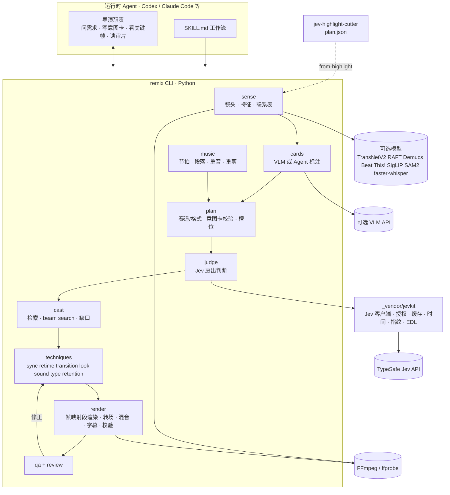
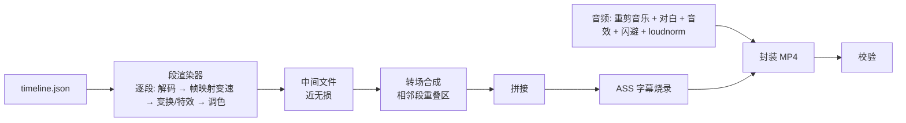

# jev-remix-cutter Skill 详细设计方案（供 GPT-6 Sol 落地实现）

> 归档设计资料：此文包含未实现的规划与当时的执行建议，不是当前 Skill 操作指令；实际能力和时长上限以 [SKILL.md](../SKILL.md) 与 [coverage.md](coverage.md) 为准。公开版已移除私人调研文档标识。
> **结论**：混剪单独做一个 Skill，命名 `jev-remix-cutter`，**不和 **<strong>`jev-highlight-cutter`</strong>** 合并**。两者共用一个从 highlight-cutter 抽出来的小底座 `jevkit`（Jev 客户端、上传确认、缓存、时间约定、源文件指纹、运行目录与失效规则），再通过 EDL 契约串起来：highlight-cutter 先从长视频里挑出高光，remix 拿这些高光当素材做卡点混剪。
>
> **这个 Skill 做什么**：多段已有素材 + 一首音乐（或一段旁白）+ 一句话需求 → 15–90 秒的卡点混剪、二创短片或预告风短视频，每一刀都能回看理由、一键换成备选。
>
> **怎么做**：形态和 highlight-cutter 一样，是“Skill 工作流 + Python CLI”。Agent 负责理解素材和创作，Jev 负责大量判断，CLI 负责所有计算、编排和渲染。数据契约与 混剪引擎方案（外部调研资料未随仓库公开） 中的 cutter-remix IR 对齐，以后可以把渲染和编排换成 Rust 版 cutter。手法细节以 混剪手法全景调研（外部调研资料未随仓库公开） 为准。

---

## 1. 合并还是单独：判断依据

### 1.1 jev-highlight-cutter 现在是什么

据它的 README 和 SKILL.md：这是一个给 Codex 等 Agent 用的 **Skill + Python CLI**，核心 CLI 只依赖 Python 标准库。工作流是 `init → (transcribe) → index → candidates → events.json → score --prepare / --allow-text-upload → plan → review → render → feedback`。它从长访谈、播客、直播的转录里召回候选窗口，Jev 用五个 Score 维度（value、hook、completeness、emotion、taste）和三个 Noul（complete、usable、excluded）打分，再用带时长预算的加权区间调度选出不重叠的片段，按原片顺序、保留原声输出粗剪和 JSON EDL。它明确不加字幕、配音、BGM[citation](https://github.com/gnipbao/jev-highlight-cutter) [citation](https://github.com/gnipbao/jev-highlight-cutter/blob/main/SKILL.md)。

### 1.2 两者的差异

| 维度 | jev-highlight-cutter | jev-remix-cutter |
| --- | --- | --- |
| 时间骨架 | 原片时间线，按原片顺序排列 | 音乐的节拍网格（或旁白的词级时间），顺序完全重排 |
| 选择单位 | 语义事件（一组问答、一段故事），25–90 秒窗口 | 镜头，0.2–3 秒 |
| 证据来源 | 转录文字为主，视觉证据由 Agent 补充 | 每个镜头的画面特征（运动、构图、色彩）为主，台词为辅 |
| 优化器 | 加权区间调度 + 时长预算 | 槽位适配 + 相邻衔接的序列优化（beam search） |
| 渲染 | 原声切片拼接 | 变速、转场、调色、重音特效、音乐重剪、音效、字幕 |
| 依赖 | 核心仅标准库 + FFmpeg | 至少 numpy、OpenCV、音频分析库；高质量档需要 GPU 模型 |
| 合规重点 | 文字上传授权 | 文字和图像上传授权，再加素材版权和“消重”红线 |
| 触发语句 | “五小时剪成八分钟”“剪精彩部分” | “按这首歌卡点”“做个高燃混剪 / AMV / 假预告” |
| 评测方式 | 高光召回、人工保留率、边界修正时间 | 卡点误差、衔接流畅度、色差、盲测偏好 |

### 1.3 建议单独做的四个理由

1. **触发会互相干扰。** Agent 在启动时只读每个 Skill 的 `name` 和 `description`，靠描述决定用哪个；选中后才读完整的 SKILL.md[citation](https://developers.openai.com/codex/skills)。两件事塞进一个描述，触发词会变宽，“剪精彩部分”可能误触发混剪流程。合并后的 SKILL.md 也会变长，每次都把用不到的那一半工作流读进上下文。

2. **依赖重量不同。** highlight-cutter 的核心只用标准库，这是它安装简单的卖点。混剪至少要 numpy 和 OpenCV，高质量档还要 PyTorch。合并会把它拖重。

3. **已验证的行为不该被拖着改。** highlight-cutter 的区间调度、严格时长模式、失效规则都已经过测试。混剪还在早期，迭代快，放在一起会让两边互相牵制。

4. **风险等级不同。** 混剪大量处理影视、动漫、体育素材，要上传截图做视觉标注，还要面对平台对“消重”的打击。这些闸门不应该加到访谈剪辑的流程里。

**什么时候值得合并**：如果以后想给终端用户一个统一入口，可以再加一个很薄的路由 Skill `jev-video`，只负责判断该用哪一个。现在不需要。

### 1.4 共享什么、怎么共享

把 highlight-cutter 里与业务无关的部分抽成 `jevkit`，**保持只用标准库**，以副本形式放进两个 Skill 的 `_vendor/jevkit/`，带版本号和同步脚本。每个 Skill 仍然可以单独安装，运行时互不依赖。

| `jevkit` 模块 | 内容 | 来自 highlight-cutter 的现有约定 |
| --- | --- | --- |
| `jev.py` | `POST /v1/systemone` 客户端、Bearer 认证、禁止重定向带密钥、重试、并发 | 默认固定 `jev-1.13.0`；并发默认 4、最多 8；网络错误和部分 429/5xx 最多试 3 次[citation](https://github.com/gnipbao/jev-highlight-cutter/blob/main/docs/jev-api.md) |
| `consent.py` | `--prepare` 生成 `transfer-preview.json`，`--allow-text-upload` 才真正发送 | 同 |
| `cache.py` | 按请求内容哈希缓存，失败写部分结果并退出 2，可续跑 | 同 |
| `keys.py` | 只读 `TYPESAFE_API_KEY`，只检查是否存在，不打印；`--key-file` 兜底 | 同 |
| `timebase.py` | 源时间用整数微秒、半开区间 `[start_us, end_us)`；输出时间用整数帧；不假设源素材恒定帧率 | 同[citation](https://github.com/gnipbao/jev-highlight-cutter/blob/main/references/contracts.md) |
| `fingerprint.py` | 源文件指纹：大小、纳秒修改时间、首尾 1 MB 哈希 | 同 |
| `rundir.py` | 运行目录在 Skill 目录之外、`history/` 版本、失效判断、拒绝渲染过期计划 | 同 |
| `edl.py` | JSON EDL v1 读写；v2 在 v1 上**只加可选字段**（变速、变换、转场、调色、特效、音频），旧读取器忽略即可 | v1 = 源 in/out + 输出帧 in/out |

### 1.5 两个 Skill 怎么串起来

典型场景：“把这场五小时直播先挑出高光，再做成 60 秒卡点混剪”。

```bash
# 1) highlight-cutter 正常跑到 plan
# 2) remix 把 plan 里选中的片段导入成素材池，转录和证据一起带过来
remix ingest --run "$RUN" --from-highlight "$HL_RUN/plan.json"
```

`--from-highlight` 读取 highlight 的 `plan.json` 和 `candidates.json`，把每个选中区间当作一个素材来源，保留它的转录、`visual` 描述和 Jev 分数作为镜头卡的附加证据。方向只有这一条：remix 不回写 highlight 的运行目录。

---

## 2. Skill 定位与触发边界

### 2.1 Frontmatter

Agent Skills 标准要求 `name` 和 `description` 两个字段，`license`、`compatibility`、`metadata`、`allowed-tools` 可选[citation](https://www.skillsboard.sh/codex-skills)。描述要写清楚什么时候该用、什么时候不该用[citation](https://developers.openai.com/codex/skills)。

```yaml
---
name: jev-remix-cutter
description: >-
  把多段已有视频素材按音乐或旁白重新组织成卡点混剪、二创短片和预告风短视频：
  镜头切分与镜头卡、节拍网格、Jev 为候选镜头和镜头衔接打分、全局编排，
  再做变速、转场、调色、音效、字幕，本地 FFmpeg 渲染，每一刀可回看理由并替换。
  用于“做个高燃/燃向混剪”“按这首歌卡点”“剪 AMV/CP 向/角色向”“做假预告/对比剪辑”
  “照这条爆款的节奏剪我的素材”等请求。
  不用于从单条长访谈、播客、直播里按时长挑原声高光（使用 jev-highlight-cutter）；
  不做消重和去水印；换脸只用于匿名化或双方书面授权的情况，并强制加 AI 标识；不做仿声。
license: MIT
metadata:
  version: "0.1.0"
  jevkit: "1.0.0"
---
```

### 2.2 范围：v1 与完整覆盖

v1（M0–M6）是第一个可交付版本；M7–M8 补齐《混剪手法全景调研》和混剪引擎方案里的其余能力；v2 是工程量大、自动化效果不确定的部分。**调研里的 92 项技巧和五大手法，每一项落在哪个模块、哪个里程碑，见附录 C 的覆盖矩阵。**

| 阶段 | 包含 |
| --- | --- |
| v1（M0–M6） | 1–50 个素材文件，总时长不超过约 5 小时（建议值）；音乐驱动、旁白驱动两种时间线；声画同步与卡点主干（一击、快闪、抽帧、定格、缩放、震屏、层级调度、反拍、静默）；velocity 等核心变速；硬切 / 动作匹配 / 运镜延续 / 甩镜 / 闪白 / 溶解 / 遮罩转场；调色统一与局部彩色、遮幅、段落 Look 例外；音乐重剪、sped up / slowed、音效自动布点；逐词字幕、金句、登场卡、片名与排行编号；3 秒钩子、变化间隔、循环结尾；5 个赛道包 + 3 个格式包；审片、替换锁定、反馈、变体 |
| M7 | 卡点与包装扩展：波形同步、歌词关键词切点、三屏卡点、剪映模板化变体、变装卡点；拖影、延时；跳切、硬反差切、插入镜头、隐形剪辑；新模块 `fx_pack` 基础档（分屏 / 画中画、描边、故障 / VHS / CRT、overlay、虚拟运镜、镜像万花筒、文字遮罩）；辉光 / 锐化 / 动态模糊；低通扫频与功能性音效；打字机、歌词动态排版、弹幕；静音测试、倒叙开场；声画对位；意境向格式 |
| M8 | 叙事与合成：交叉剪辑、蒙太奇（含反应镜头嫁接、正反打、闪回）；形状 / 位置 / 颜色 / 光线匹配、缩放穿越、变形转场；`fx_pack` 高级档（人物出框、漫画分格、2.5D 视差、抠像换背景、动态跟踪贴字）；剧情重剪、跨作品联动、鬼畜调教、空耳重配、角色 / CP / 名场面排行、反转剪辑、TikTok edit 子风格等格式包；爆款反推 |
| v2 | 人力 VOCALOID、音 MAD、人声切片变调、mashup、口型匹配、分身、AE 级技术实验向（粒子、3D、玻璃破碎等）、可选 Rust 后端 |
| M9 | 授权换脸 / 匿名化模块 `face`：同意登记册、打码、换成不存在的合成人脸、双方书面授权的换脸、强制显式与隐式 AI 标识、审计日志（详见 [增补设计](design-face-originality.md)） |
| 始终不做 | 消重类处理（由 v1 的原创度模块 `originality` 代替，见增补设计第 2 节）、去水印、未授权换脸、仿声；自动发布；原生剪映 / Premiere 工程（只导出 JSON EDL v2，可选 OTIO） |

---

## 3. 设计原则

1. **Skill 是工作流，CLI 是确定性执行。** SKILL.md 只写“什么时候做什么、做到什么程度算过关”；所有数值计算、优化、渲染都在 CLI 里，可以单测、可以重放。

2. **Agent 理解与创作，Jev 判断，代码计算。** 运行时使用这个 Skill 的 Agent 就是“导演”：问需求、写剪辑意图卡、看关键帧、解释审片结果。成千上万次“合不合适”交给 Jev。节拍、时长、色差、优化交给代码。

3. **数在代码里，词给 Jev。** Jev 只接受文本[citation](https://nexos.ai/blog/what-is-jev/)。所有数值特征经过 `verbalize()` 离散成词档再进 state。

4. **绝不伪造。** 不能把本地猜分标成 Jev 分；不能在没看画面时编造镜头卡；不能在节拍检测失败时假装卡上了。缺什么就明确报告缺什么，这一条直接沿用 highlight-cutter 的做法。

5. **先预览，再上传。** 文字发给 TypeSafe、截图发给视觉模型，都必须先生成预览文件、拿到用户授权，再用显式开关发送。两类授权分开记录。

6. **素材授权是硬闸门。** 每个来源必须声明 `own`、`licensed` 或 `unknown`。`unknown` 可以剪、可以预览，正式导出前必须再次确认。

7. **原片只读，运行目录在 Skill 外，任何改动都能重放。** 上游变了，下游自动标记过期，渲染拒绝过期计划。

8. **契约先于实现。** 先定 JSON Schema，再写代码。所有文件格式和 cutter-remix 的 IR 字段一一对应，留出换成 Rust 后端的空间。

---

## 4. 架构



---

## 5. 仓库结构

```plaintext
jev-remix-cutter/
├─ SKILL.md                      # 一页工作流（附录 A 草稿）
├─ README.md                     # 安装、配置、命令总览、排错
├─ LICENSE
├─ pyproject.toml                # 依赖分层：core / asr / quality / vlm（第 11 节）
├─ scripts/
│  └─ remix.py                   # CLI 入口；未安装依赖时给出明确提示
├─ src/jev_remix/
│  ├─ cli.py                     # 子命令注册、--json 输出、退出码
│  ├─ contracts/                 # JSON Schema（*.schema.json）+ 读写与校验
│  ├─ sense/                     # shots.py features.py contact_sheet.py faces.py
│  ├─ cards/                     # prepare.py provider_vlm.py agent_import.py verbalize.py
│  ├─ music/                     # beats.py sections.py accents.py stems.py edit.py
│  ├─ plan/                      # packs.py intent.py slots.py narration.py
│  ├─ judge/                     # questions.py fanout.py fuse.py
│  ├─ cast/                      # retrieve.py beam.py gaps.py
│  ├─ techniques/                # sync.py retime.py transition.py look.py sound.py type.py retention.py
│  │                             # cuts.py fx_pack.py（M7）；cross_cut.py montage.py（M8）
│  ├─ render/                    # segment.py transitions.py audio.py subtitles.py verify.py
│  ├─ review/                    # build_html.py server.py feedback.py
│  ├─ originality/               # metrics.py catalog.py report.py（M6）
│  ├─ face/                      # consent.py scan.py match.py plan.py backends/ blend.py label.py audit.py（M9）
│  └─ qa/                        # metrics.py report.py
├─ _vendor/jevkit/               # 与 highlight-cutter 共用的底座副本，带 VERSION
├─ questions/                    # Jev 问题库 *.yaml（带版本号）
├─ thresholds.toml               # 所有阈值，代码中不出现魔法数字
├─ packs/
│  ├─ platform-profiles/         # 原创度提示阈值（用户可编辑，非平台官方规则）
│  ├─ tracks/                    # film-epic.json emotional.json amv.json car.json ecommerce.json
│  └─ formats/                   # v1：recut-trailer side-by-side still-mad；M7–M8 增补见 10.9
├─ assets/
│  ├─ luts/                      # 只放可再分发的 LUT
│  ├─ sfx/                       # 只放可商用授权音效，附 LICENSES.md
│  ├─ overlays/                  # 漏光、灰尘、闪粉等透明叠加素材（M7，只收可商用授权）
│  └─ ass/                       # 字幕样式模板
├─ references/                   # Agent 按需读取（第 6.3 节）
│  ├─ contracts.md
│  ├─ techniques.md              # 五大手法 + 扩展手法的做法、参数、翻车点
│  ├─ tracks-and-formats.md
│  ├─ intent-card.md             # 意图卡写法与完整示例
│  ├─ review-checklist.md
│  └─ compliance.md
├─ tests/                        # 单元测试 + 合成素材端到端测试
└─ evals/                        # 真实素材评测协议与记录模板（不含素材本身）
```

`references/techniques.md` 和 `tracks-and-formats.md` 的内容，从归档调研资料（混剪引擎方案第 7–8 节、手法全景调研第 1–8 节）整理过来，每个手法压缩成“做法、参数、什么时候用、翻车点”四行。

---

## 6. 工作流（SKILL.md 的主体）

### 6.1 步骤

| # | 步骤 | Agent 做什么 | CLI | 过关标准 |
| --- | --- | --- | --- | --- |
| 0 | 环境检查 | 运行 doctor，缺什么装什么 | `remix doctor` | FFmpeg、核心依赖就绪；Jev 密钥只报告“有 / 无” |
| 1 | 接收与分流 | 读需求，判断是否属于本 Skill（单条长视频挑原声高光 → 转给 highlight-cutter）。只补问最影响结果的 1–2 个问题（赛道 / 时长 / 画幅 / 主角），最多两轮；用户说“你看着剪”就用赛道默认值 | — | 目标时长、画幅、赛道或格式、音乐来源已确定 |
| 2 | 建立运行目录 | 在 Skill 目录外建运行目录，写入 brief | `remix init`、`remix configure` | `brief.json` 通过 Schema 校验 |
| 3 | 导入与索引 | 逐个声明素材授权状态 | `remix ingest`（可加 `--from-highlight`） | 每个来源都有指纹、授权状态；镜头切分和数值特征完成 |
| 4 | 镜头卡 | 选择 VLM 模式（需图像上传授权）或 Agent 模式（自己看联系表写卡片） | `remix cards --prepare / --provider / --import` | 所有入选候选的镜头都有卡片，每张卡片标明来源 |
| 5 | 音乐 | 确认音乐，必要时让 CLI 把音乐重剪到目标时长 | `remix music`、`remix music-edit` | 节拍网格、段落、重音就绪；节拍置信度低的段落已标出 |
| 6 | 规划 | 选赛道包或格式包；**写剪辑意图卡**（主题、弧线、线索、蒙太奇概念、对位点、避免项）；运行槽位展开 | `remix intent --validate`、`remix slots` | 意图卡通过校验；槽位数和时长与音乐对上 |
| 7 | Jev 判断 | 先看传输预览和请求量，取得文字上传授权后再发送 | `remix score --prepare`，然后 `--allow-text-upload` | 每个请求都有结果或明确失败；记录模型版本和用量 |
| 8 | 选角编排 | 阅读缺口报告，决定放宽条件、合并槽位还是请用户补素材 | `remix cast` | 无未处理的缺口；`cast.json` 生成 |
| 9 | 应用手法 | — | `remix assemble` | `timeline.json` 通过校验 |
| 10 | 审片 | 打开审片页；**亲眼看**钩子、第一个 drop、结尾这几个关键槽位的联系表；必要时替换或锁定 | `remix review`、`remix frames --slots`、`remix swap`、`remix lock` | 关键槽位已人工或 Agent 视觉确认 |
| 11 | 预览渲染与质检 | 读质检报告，按问题类型修正，最多两轮 | `remix render --preview`、`remix qa` | 质检无“错误”级问题 |
| 12 | 交付 | 正式渲染；检查 `unknown` 授权素材；报告成片、EDL、未解决的警告 | `remix render`、`remix export` | 校验通过：帧数、切点、音轨、响度、闪烁安全 |
| 13 | 反馈与复用 | 用户反馈写回后重排；出变体；只有用户要求时才保存长期偏好 | `remix feedback`、`remix variants`、`remix export-profile` | 历史版本保留 |

### 6.2 Agent 的硬性规则（写进 SKILL.md）

- 镜头卡、动作峰值、情绪标签，只能来自视觉模型的输出或 Agent 实际看过的画面。没看到就标 `uncertain`，不能根据文件名或台词猜。

- Jev 分数只能来自 Jev。`--mock` 只用于测试，审片页和交付报告必须标出 mock 结果，渲染对 mock 计划默认拒绝。

- 不打印、不索要、不写入 API 密钥。

- 文字上传授权和图像上传授权分开取得、分开记录，不扩展到别的运行目录。

- 不实现、不建议镜像消重、抽帧消重、改 MD5、去水印、仿声；用户要求“消重”时说明原因，并改用原创度模块（`remix originality`）给出能增加作品自身贡献的改法。

- 换脸只用于两种情况：匿名化，或被换掉脸的人和换上去的脸的主人都在同意登记册中。不代用户执行 `consent add`，不编造授权书；给演员、明星、公众人物换脸，或把用户的脸换进影视片段，需要被替换者本人书面授权，没有授权时只提供打码或匿名化；不移除、遮挡、缩小 AI 标识；涉及未成年人、色情内容、冒充真实人物进行欺骗时直接拒绝。

- 交付时如实报告：哪些槽位是缺口补位、哪些素材授权未知、哪些质检警告没有修。

### 6.3 references 的读取时机

| 文件 | 什么时候读 |
| --- | --- |
| `contracts.md` | 需要手写或修改 `intent.json`、`events`、`feedback.json` 时 |
| `intent-card.md` | 第 6 步写意图卡之前 |
| `techniques.md` | 用户点名某种手法，或审片要改某类问题时，只读对应小节 |
| `tracks-and-formats.md` | 第 1 步选赛道 / 格式时，只读候选的那几个 |
| `review-checklist.md` | 第 10、11 步 |
| `compliance.md` | 出现 `unknown` 授权、用户要求消重或换脸、或要上传素材时 |

---

## 7. CLI 规格

**全局约定**：所有子命令都接受 `--run <dir>` 和 `--json`。`--json` 时标准输出只打印一个 JSON 对象，便于 Agent 解析。路径一律作为进程参数传给子进程，不拼进 shell 字符串。

**退出码**：`0` 成功；`2` 可恢复的失败或不可行（如部分 Jev 请求失败、时长不可达）；`3` 计划过期，需要按提示重建；`4` 需要授权（上传、授权未知素材的正式导出）；`5` 缺少依赖。

| 命令 | 作用 | 主要参数 | 输出 |
| --- | --- | --- | --- |
| `doctor` | 检查 FFmpeg、Python 包、可选模型、GPU、密钥是否存在 | `--tier core\|quality` | 依赖报告 |
| `init` | 新建运行目录，不覆盖已有目录 | `--run`、`--fps`、`--format 9:16\|16:9\|1:1` | `brief.json` |
| `configure` | 对 brief 做经过校验的局部修改 | `--patch brief-patch.json` | 新版 `brief.json`，旧版进 `history/` |
| `ingest` | 导入素材、指纹、规整、镜头切分、数值特征 | `--src <path>... --license own\|licensed\|unknown`、`--from-highlight <plan.json>` | `sources.json`、`shots.jsonl`、`features/` |
| `cards` | 生成镜头卡 | `--prepare`（生成联系表和待标注清单）、`--provider <name> --allow-image-upload`、`--import <cards.jsonl>`（Agent 模式） | `cards.jsonl`、`image-transfer-preview.json` |
| `music` | 节拍、强拍、段落、重音、能量；可选分轨和歌词对齐 | `--audio <path>`、`--stems`、`--lyrics` | `music.json` |
| `music-edit` | 在乐句边界把音乐剪到目标时长 | `--target-s`、`--keep chorus` | `music.edited.wav`、更新后的 `music.json` |
| `intent` | 校验 Agent 写的意图卡 | `--validate <intent.json>` | `intent.json` |
| `slots` | 按赛道 / 格式包 + 音乐 + 意图卡展开槽位 | `--pack <id>`、`--mode music\|narration` | `slots.json` |
| `score` | Jev 判断：槽位适配、镜头衔接、离群检查等 | `--prepare`、`--allow-text-upload`、`--workers`、`--model`、`--mock` | `transfer-preview.json`、`scores.jsonl`、`cache/jev/` |
| `cast` | 检索、融合打分、beam search、缺口检测 | `--k`、`--pairs`、`--beam` | `cast.json`、`gaps.json` |
| `assemble` | 依次应用 sync → retime → transition → look → sound → type → retention | `--only <technique>` | `timeline.json` |
| `review` | 生成审片页，可选启动本地服务 | `--serve`、`--port` | `review.html` |
| `frames` | 为指定槽位或时间生成联系表 | `--slots hook,drop1,end`、`--times` | `frames/*.jpg` |
| `swap` / `lock` | 换成备选或指定镜头 / 锁定槽位 | `--slot`、`--rank` 或 `--shot` | 新版 `cast.json` |
| `render` | 渲染并校验 | `--preview`（最高 720p） | `renders/<plan-id>/` |
| `qa` | 自动质检 | — | `qa.json` |
| `feedback` | 应用审片页导出的反馈 | `--file feedback.json` | 新版 brief / cast |
| `variants` | 按参数表批量出变体 | `--table variants.json` | 多个 timeline 与渲染 |
| `export` | 导出 EDL v2，可选 OTIO | `--format edl\|otio` | `edl.json` |
| `explain` | 某个槽位的决策记录 | `--slot` | 得分、理由、前三备选 |
| `export-profile` | 只在用户明确要求时保存长期偏好 | `--name` | 偏好文件（带版本） |
| `originality`（M6） | 原创度报告与改法 | `--profile` | `originality.json` |
| `license-catalog`（M6） | 导入授权片单并关联来源 | `--import`、`--map` | 来源授权与使用约束 |
| `consent`（M9） | 同意登记册：`add`（仅限用户在交互终端执行）、`list`、`revoke`、`verify` | 见增补设计 3.3 | `~/.config/jev-remix/consents/` |
| `faces`（M9） | `scan`、`match`、`plan`、`prepare`、`apply`、`qa` | 见增补设计 3.5 | `faces.json`、`face-plan.json`、`face-audit.jsonl` 等 |

---

## 8. 数据契约

### 8.1 运行目录

```plaintext
$RUN/
├─ brief.json                 # 需求、赛道/格式、时长、画幅、fps、授权记录（文字/图像分开）
├─ sources.json               # 素材：路径、指纹、授权、编码信息、来源（file | highlight）
├─ shots.jsonl                # 镜头区间（源时间微秒，半开）
├─ features/<shot>.npz        # 数值特征：光流、运动曲线、峰值、质心、Hu 矩、Lab 统计……
├─ contact/                   # 联系表图片（Agent 模式标注用）
├─ cards.jsonl                # 镜头卡文字部分 + provenance
├─ image-transfer-preview.json
├─ music.json                 # 节拍网格、段落、重音、能量、歌词词级时间
├─ intent.json                # Agent 写的剪辑意图卡
├─ slots.json
├─ transfer-preview.json      # 将要发给 Jev 的完整文字请求，不含密钥
├─ scores.jsonl               # Jev 结果：模型、各题答案、置信度、用量、请求哈希
├─ cache/jev/
├─ cast.json                  # 每个槽位的选中镜头、融合分、前三备选、锁定状态
├─ gaps.json
├─ timeline.json              # 渲染的唯一输入
├─ edl.json                   # EDL v2
├─ qa.json
├─ review.html
├─ renders/<plan-id>/         # preview.mp4 / final.mp4 / verification.json / timeline 快照
└─ history/
```

### 8.2 时间约定

沿用 `jevkit.timebase`：源时间是相对于呈现起点的整数微秒，区间半开；输出时间是整数帧（默认 30 fps）；源素材可能是可变帧率，按时间戳取帧，不按“帧号 × 帧时长”推算。节拍时间按输出帧率取整到最近帧后才进入槽位。

### 8.3 关键文件示例

**镜头卡（**<strong>`cards.jsonl`</strong>** 的一行）**

```json
{
  "shot_id": "src03#s0412",
  "words": {
    "画面": "雨夜天台，主角握刀转身，反派从画面左侧逼近",
    "人物": ["主角", "反派"], "景别": "中景", "运镜": "手持跟随",
    "主体运动": "主角快速向右转身", "运动强度": "剧烈",
    "动作峰值": "有，在镜头后半段", "主色": ["深青", "琥珀"],
    "亮度": "偏暗", "情绪": "紧张", "叙事功能": "对峙", "表情": "难以判断"
  },
  "verbalized_from": ["运镜", "主体运动", "运动强度", "主色", "亮度"],
  "provenance": {"mode": "provider", "model": "<vlm-model-id>", "frames": ["first", "mid", "last", "peak"], "uncertain": []}
}
```

`verbalized_from` 列出哪些字段来自代码离散化，其余来自视觉模型或 Agent。Agent 模式下 `provenance.mode = "agent"`，必须列出实际看过的联系表文件名。

**时间线条目（**<strong>`timeline.json`</strong>** 的 **<strong>`items`</strong>** 之一）**

```json
{
  "slot": "drop.07",
  "out": {"start_f": 960, "end_f": 975},
  "src": {"source": "src03", "in_us": 412350000, "out_us": 413150000},
  "retime": {"preset": "hit_slowmo", "points": [[0.0, 1.4], [0.45, 0.25], [0.6, 0.25], [1.0, 1.0]], "interp": "rife"},
  "transform": {"keys": [{"f": 0, "scale": 1.0}, {"f": 2, "scale": 1.06}, {"f": 6, "scale": 1.0}]},
  "transition_in": {"type": "flash_white", "frames": 2},
  "look": {"preset": "teal-orange-hc", "strength": 0.6, "match_alpha": 0.7, "ref_shot": "src01#s0088"},
  "fx": [{"type": "shake", "kind": "xy", "px": 12, "frames": 6, "at_f": 0}],
  "sfx": [{"type": "impact", "at_f": 0}],
  "reasons": {
    "technique": ["sync:peak_to_beat", "sync:accent"],
    "jev": {"slot_fit": 3.0, "mood_match": 0.91, "relation_to_prev": "escalate"},
    "fused": 0.87, "alternatives": ["src07#s0121", "src02#s0033"]
  }
}
```

`retime.points` 是归一化时间与速度的折线，最慢点由 `sync` 模块对齐到动作峰值。

### 8.4 失效规则

| 改动 | 失效范围 |
| --- | --- |
| 素材文件指纹变化 | 该来源的 shots、features、cards，以及之后全部 |
| 镜头卡改动 | 涉及这些镜头的 Jev 分数、cast、timeline |
| 音乐或 music-edit 改动 | slots 及之后全部 |
| brief / 赛道包 / 意图卡改动 | slots 及之后全部 |
| 问题库版本或 Jev 模型改动 | scores 及之后全部（缓存键包含两者） |
| swap / lock / feedback | cast 及之后 |
| thresholds.toml 改动 | 受影响的 cast、qa |

`render` 遇到过期的 timeline 或指纹变化时拒绝执行，退出码 3，并给出需要重跑的命令序列。

---

## 9. Jev 集成规格

### 9.1 客户端行为

全部沿用 `jevkit`（见 1.4）：固定 `jev-1.13.0`；`--prepare` 不读密钥、不发请求，只写 `transfer-preview.json`（含请求数和估算 token 数）；`--allow-text-upload` 才发送；按请求内容缓存；失败写部分结果并退出 2；每条结果记录返回的 `model` 和 `usage`。价格不写死在代码里，以官方控制台为准[citation](https://github.com/gnipbao/jev-highlight-cutter/blob/main/docs/jev-api.md)。

**缓存键**：`sha256(model ‖ 规范化后的 state ‖ 规范化后的 questions ‖ 问题库版本)`。

### 9.2 问题库格式

问题文本只写在 `questions/*.yaml` 里，代码只按 ID 引用：

```yaml
version: 3
questions:
  slot_fit:
    type: score
    used_by: [cast]
    instructions: "候选镜头放在这个位置，满足“需要”一栏所描述内容的程度"
    criteria:
      - "不满足：内容与需要无关"
      - "勉强：沾边，但明显会有更合适的镜头"
      - "满足：内容符合需要"
      - "非常满足：几乎就是为这个位置准备的"
    normalize: score_over_max
  mood_match:
    type: noul
    used_by: [cast]
    instructions: "候选镜头传达的情绪与这个位置要求的情绪一致"
    normalize: prob
  transition_type:
    type: choice
    used_by: [transition]
    instructions: "从“本处允许的转场”中，为前镜结尾接后镜开头选出最合适的处理方式"
    criteria:
      hard_cut: "两镜内容和动势自然连贯，直接硬切就很顺"
      match_action: "前镜的动作在后镜中延续，在动作中段切换最顺"
      camera_move: "两镜运镜方向和速度相近，借运动模糊可以无缝衔接"
      light: "借闪白、过曝或黑场过渡比直接切更好"
      incompatible: "这两个镜头不适合相邻"
```

Jev 看不到问题 ID，要求必须写在 `instructions` 和选项描述里；读同一份 state 的问题放进同一个请求；有依赖的问题分两次请求[citation](https://madewithjev.com/how-to-use-jev)。完整问题清单见混剪引擎方案附录 A，v1 先实现以下 10 道：`slot_fit`、`mood_match`、`focus_on_required_char`、`relation_to_prev`、`transition_type`、`smoothness`、`meaningful_link`、`grade_outlier`、`slowmo_worth`、`sfx_type`。M7–M8 增补的问题见 10.6.1。

### 9.3 请求组装规则

- state 只放这道题需要的字段：槽位需要 + 上一镜摘要 + 候选卡片的 `words`。不放整张卡片、不放数值。

- 每个（槽位，候选）一个请求；每个（前镜尾，后镜头）一个请求。批量把多个候选塞进一个 state 的做法默认关闭，要先在评测集上证明不掉准确率。

- 请求数上限写在 `thresholds.toml`（建议默认 3,000 / 运行），超过时 `--prepare` 报告并建议降低 K。

### 9.4 Mock 模式

`--mock` 按请求哈希生成确定性的伪答案，每条结果带 `"mock": true`。只用于测试和离线开发；`render` 遇到含 mock 分数的 cast 默认拒绝，需显式 `--allow-mock` 且成片文件名带 `MOCK`。

---

## 10. 模块实现规格

每个模块的交付物都是四件：输入输出 Schema、实现、单元测试、一个合成素材上的端到端断言。

### 10.1 sense：镜头与数值特征

- **规整**：ffprobe 读编码、帧率、色彩空间、HDR 标记；生成 540p 恒定帧率代理文件放在运行目录；`cropdetect` 检测黑边。

- **镜头切分**：core 档用 PySceneDetect 的内容检测；quality 档用 TransNetV2。丢弃短于 6 帧的碎片（阈值在 `thresholds.toml`）。

- **运动**：core 档用 OpenCV DIS 或 Farneback 稠密光流（CPU 可跑）；quality 档用 RAFT。输出首尾 8 帧平均光流、运动强度曲线、动作峰值帧、机位运动分类。动画素材先检测重复帧再计算。

- **色彩**：Lab 均值和方差、k-means 主色、亮度、饱和度、色温估计、闪白事件。

- **主体**（quality 档）：SAM 2 或显著性检测得到首尾主体质心、面积、Hu 矩。core 档退化为显著性图的质心和面积。

- **质量**：拉普拉斯方差、OCR 检测硬字幕与台标区域（只用于避开）。

- **联系表**：每个镜头取首、中、尾和峰值帧，按 4×4 拼图，图上标镜头 ID，供 Agent 模式标注和审片使用。

### 10.2 cards：镜头卡

- **Provider 模式**：调用配置的视觉模型（BYOK，环境变量配置），按固定 JSON Schema 输出卡片字段。发送前生成 `image-transfer-preview.json`，必须带 `--allow-image-upload`。

- **Agent 模式**：`--prepare` 生成联系表和待标注清单（每批 16 个镜头）；Agent 看图后写 `cards.agent.jsonl`；`--import` 校验字段和词表后合并。适合素材少、或不允许上传图片的情况。

- **只标注候选**：先用数值特征和授权过滤，素材多时只给可能入选的镜头做卡片（默认上限 600 个，可配置），控制成本。

- <strong>`verbalize()`</strong>：唯一的数值转文字出口，按素材池分位数切档，词表见混剪引擎方案 4.3。必须有单元测试覆盖每个特征的边界值。

### 10.3 music：音乐图谱与重剪

- **节拍**：core 档用 librosa 的节拍跟踪和起音检测；quality 档用 Beat This! 或 all-in-one（同时给段落）。输出拍、强拍、BPM、段落、能量曲线、重音（按低频 / 中频能量区分 kick、snare 类）、静默与 drop 候选。每段给一个节拍置信度。

- **分轨**（quality 档，`--stems`）：Demucs 分出鼓、贝斯、人声、其他，分别做事件检测，供“卡点层级调度器”使用。

- **歌词**（`--lyrics`）：对人声轨跑 faster-whisper 得到词级时间。

- **music-edit**：在 4 或 8 小节的乐句边界上剪接，接点放在强拍并做 20–50 ms 交叉淡化（建议值），让成片落在完整乐句上；不做隐性变速凑时长。不可达时报告最接近的两个长度。

### 10.4 plan：意图卡与槽位

- **意图卡**由 Agent 写，CLI 只校验：主题、弧线、钩子要求、线索、蒙太奇概念、对位点、Look 例外、避免项。格式见 `references/intent-card.md`。

- **槽位展开**：

  - 音乐模式：赛道包结构骨架 × `music.json` 段落 × 密度档（`2bar`、`1bar`、`2beat`、`1beat`、`halfbeat_burst`、`heavy_only`）。

  - 旁白模式：以旁白转录的句子为单位，每句生成 1–3 个槽位，时长按词级时间分配；音乐只做铺底。

- 每个槽位带：锚点、作用、手法、`need` 文本、情绪、过滤条件、允许的入场转场、同步规则。

### 10.5 cast：检索、判断、编排

1. 硬过滤：授权、质量标记、角色、强度下限、长度（不够时检查是否允许变速）、避免项。

2. 召回：`need` 文本对镜头首中尾帧做文本-图像嵌入检索（quality 档 SigLIP）+ 卡片文字 BM25（core 档只用 BM25），取 top-K（默认 20），MMR 去同质。

3. Jev 判断（`score`）：槽位适配四题；相邻槽位前 5 × 前 5 的衔接三题。

4. 融合与编排：融合分 $$F(i,c)=\sum_k \alpha_k q_k(i,c)$$，衔接分 $$T$$，目标函数与惩罚项同混剪引擎方案 6.4；beam search 默认宽度 32。

5. 缺口：某槽位所有候选 `slot_fit` 都低于“满足”时写入 `gaps.json`，附三种处理建议（放宽过滤 / 让上一个槽位延长 / 请用户补素材）。v1 不自动调用生成模型补镜。

### 10.6 techniques:v1 实现范围

| 模块 | v1 实现 | 关键参数（初始值，写在赛道包或 thresholds） |
| --- | --- | --- |
| `sync` | 切点对齐节拍网格；动作峰值对齐重拍（入点求解）；重音特效（闪白、缩放冲击、XY / 模糊 / 旋转震屏、RGB 分离、定格）；**卡点层级调度器**（鼓 → 切点，贝斯 → 震屏，旋律滑音 → 旋转，人声 → 弹字）；快闪单帧槽位；抽帧卡点；反拍比例；静默前置（drop 前抽空一拍 + 黑场） | 视觉提前量 0–2 帧；缩放 100% → 106–110% → 100%，约 0.2 秒；每小节重音特效 ≤ 2；闪白每秒 ≤ 3 次；反拍比例 5–15% |
| `retime` | velocity 曲线模板（approach / focus / exit，4–5 个点，最慢点对齐动作峰值）；定格；倒放；回环；鬼畜循环；低帧率卡帧 | 游戏命中预设：蓄力 1.3–1.5 倍、命中 0.1–0.3 倍、定格约 0.5 秒；慢于 0.5 倍时用补帧 |
| `transition` | 硬切、动作匹配、运镜延续（方向模糊）、甩镜、闪白 / 闪黑、溶解、线性遮罩擦除、遮挡转场（quality 档） | 赛道包的转场预算；whoosh 时长 = 转场时长 |
| `look` | 技术还原（HDR 色调映射）、一级校正、按段落主镜做 Lab 均值方差迁移、LUT、颗粒、暗角、遮幅、局部彩色；意图卡 `look_override` 段落例外（回忆黑白、色彩分离） | 迁移强度 0.6–0.8；混合媒介时降低 |
| `sound` | 音乐重剪；对白 sidechain 闪避；whoosh / riser / impact / 快门声自动布点；sped up / slowed + reverb 预设；两遍 loudnorm | 对白高于 BGM 约 6 dB；响度目标 −14 LUFS 附近、真峰值 ≤ −1 dBTP（平台要求需核实） |
| `type` | 逐词字幕、歌词卡拉 OK、金句大字、登场卡、片名卡、排行编号（ASS 字幕 + libass 烧录） | 字幕提前量 2–4 帧（待 A/B） |
| `retention` | 钩子检查（前 3 秒必须从动作峰值或最强台词开始）；视觉变化最大间隔检查（\> 4 秒自动插入 10–15% 推近或弹字）；循环结尾评分（首尾帧描述子相似度） | 间隔阈值 4 秒；推近 10–15% |
| `cross_cut`、`montage` | M8 实现，规格见混剪引擎方案 7.1–7.2 | — |

各模块按 `sync → retime → cuts → transition → look → fx_pack → sound → type → retention` 的顺序修改 `timeline.json`（`cuts`、`fx_pack` 从 M7 起加入；`cross_cut`、`montage` 在 M8 加入 `shape` 阶段，即选角之前调整槽位）。每个模块只能写自己负责的字段，`assemble` 在每步之后做 Schema 校验。

#### 10.6.1 M7–M8 增补

| 模块 | M7 增补 | M8 增补 | 新增 Jev 问题 |
| --- | --- | --- | --- |
| `sync` | 波形同步（特效强度跟随能量包络）；歌词关键词出现时切画面；三屏 / 分屏卡点（每格入场锚定一拍）；剪映模板化变体拆成原子效果：甩入 = 方向模糊入场、X 开幕 = 对角遮罩展开、荧光线描 = 边缘检测发光、对焦 = 模糊到清晰、车流变速 = velocity 预设；变装卡点（同一角色不同造型的检索约束 + 遮挡转场）；声画对位的情绪反差、节奏反差、声音缺席、声音预示（只在意图卡 `counterpoint` 声明的位置使用） | 声画对位的歌词隐喻（导演 Agent 给出画面构想，代码检索，Jev 判断） | `lyric_metaphor`（score）、`accidental`（noul） |
| `retime` | 拖影 / 帧混合；延时（恒定加速）；“难插帧区域”标记（头发、手、车轮、水面），这类镜头限制慢放倍率；倒放自动配倒带音效和 VHS 质感 | 定格 + 2.5D 视差 | `reverse_ok`（noul） |
| `cuts`（新） | 跳切（前后景别相同、主体位置相近）；硬反差切（`relation_to_prev = contrast`，音频同步硬切）；插入镜头 / 切出（作为留存层的变化来源）；隐形剪辑（切点藏进黑暗或快速运动） | 反应镜头嫁接；正反打 | `jump_ok`（noul）：两镜像同一机位的时间跳跃 |
| `transition` | — | 形状 / 位置 / 颜色 / 光线匹配；缩放穿越；遮挡转场高级版（主体 mask 擦除）；光流变形（失败回退溶解） | 沿用 `transition_type`，选项扩充 |
| `look` | 辉光、锐化、动态模糊（edit 圈“质感三件套”） | — | — |
| `fx_pack`（新） | 分屏 / 画中画；描边 / 荧光线描（含定格卡点的白边）；故障 / RGB 分离 / VHS / CRT；overlay 叠加（只用 `assets/overlays/` 中有授权的素材，混合模式和时机由节拍决定）；虚拟运镜（对固定镜头做推拉摇移，方向顺着下一镜运镜）；镜像 / 万花筒（仅创意用途）；文字遮罩 | 人物出框 / 破框（SAM 2 抠主体）；漫画分格（格子构图由主体位置决定）；2.5D 视差（单目深度估计分层 + 补洞）；抠像换背景；动态跟踪贴字 / 贴特效 | `fx_choice`（choice，含“不加”）、`pop_out_fit`（noul） |
| `sound` | 低通滤波扫频（drop 前闷、drop 时打开）；功能性音效（打字、心跳、倒带） | 去人声重配（Demucs 分离 + TTS；只用通用音色，不克隆真人声音） | — |
| `type` | 打字机；歌词动态排版（放大、旋转、拆字）；弹幕叠加（文本须原创或授权） | 动态跟踪贴字（与 `fx_pack` 共用跟踪轨迹） | `impact_line`（score） |
| `retention` | 静音测试（只看字幕和画面，VLM 能否说出主要内容）；倒叙开场（钩子取自高潮段） | 爆款反推加入“最长重置间隔”指标 | `loop_seam`（score） |
| `cross_cut`、`montage` | — | 混剪引擎方案 7.1–7.2 全部：五种交叉模式、交替节奏递减、视线与方向连续性、概念碰撞、库里肖夫、积累排序、可读性测试 | `thread`、`tension`、`responds`、`evokes`、`too_literal`、`order`、`montage_readout` |

### 10.7 render：渲染管线



- **段渲染器（帧映射）**：每个时间线条目独立渲染。FFmpeg 以 rawvideo 管道解码源区间（含转场需要的前后余量）；Python 按速度折线积分出每个输出帧对应的源时间，取最近帧、帧混合或 RIFE 补帧；用 OpenCV 做缩放 / 位移 / 旋转等变换和逐帧特效；再把帧以管道送进 FFmpeg 编码，同一条命令里用 `lut3d`、`eq`、`noise` 等滤镜完成调色和颗粒。这样变速、变换、调色在一个确定的过程里完成，比拼 FFmpeg 表达式更好测。

- **中间文件**：输出分辨率和帧率下的近无损编码（如 FFV1 或高码率 H.264），按条目内容哈希缓存，改一处只重渲受影响的段。

- **转场**：相邻两段在重叠区合成。v1 用 FFmpeg `xfade` 的内置类型完成溶解、擦除；闪白、甩镜、方向模糊用 numpy 逐帧混合。

- **音频**：重剪后的音乐、保留的对白（来自分离轨）、自动布点的音效分轨混合；对白段用 `sidechaincompress` 压 BGM；最后两遍 `loudnorm`。

- **校验（**<strong>`verification.json`</strong>**）**：输出帧数等于计划帧数；对成片做场景检测，硬切位置与计划误差 ≤ 1 帧；音轨存在且长度一致；响度和真峰值达标；每秒闪白次数不超标；源文件指纹未变。任何一项失败，交付报告必须列出。

### 10.8 review 与 qa

- **审片页**（静态 HTML，可选本地服务）：上方是音乐波形和节拍网格，下方是槽位条；点槽位显示选中镜头、联系表、Jev 各题得分、融合分、前三备选、授权状态；支持“替换为备选”“锁定”“排除这个镜头”，导出 `feedback.json`。页面不联网。

- **qa 指标**：黑帧 / 冻结、切点-节拍误差、爆发段峰值上拍率、镜头时长曲线与模板的偏差、重复镜头、同源相邻、相邻色差 ΔE2000、字幕与硬字幕区域重叠、响度、对白电平差、闪烁频率、视觉变化最大间隔、循环结尾分；M7 起加入静音测试。每项分“错误 / 警告 / 通过”，阈值都在 `thresholds.toml`。

### 10.9 内置包

| 里程碑 | 类型 | ID | 说明 |
| --- | --- | --- | --- |
| v1 | 赛道包 | `film-epic` | 影视高燃：台词冷开场、交叉升级、静默前置、drop 爆发（交叉剪辑在 M8 前用简化的两线交替） |
| v1 | 赛道包 | `emotional` | 情感 / CP 向：慢节奏、回忆段专用 Look；声画对位在 M7 加入 |
| v1 | 赛道包 | `amv` | 动漫 AMV：歌词级卡点、作画峰值对重拍 |
| v1 | 赛道包 | `car` | 汽车 / 机车：velocity、贝斯震屏、运镜匹配 |
| v1 | 赛道包 | `ecommerce` | 电商素材混剪：3 秒钩子、卖点卡、品牌色、批量变体 |
| v1 | 格式包 | `recut-trailer` | 假预告：意图卡指定目标类型，Jev 按目标类型重判情绪 |
| v1 | 格式包 | `side-by-side` | 对比剪辑：两路素材按动作或台词对齐，分屏 |
| v1 | 格式包 | `still-mad` | 静止系：图片素材 + 虚拟运镜（Ken Burns）；2.5D 视差在 M8 加入 |
| M7 | 格式包 | `mood` | 意境向：低密度、长镜头、慢放、调性统一 |
| M8 | 格式包 | `story-recut` | 剧情重剪：导演 Agent 写新剧情大纲，槽位按剧情节点生成（旁白或台词驱动） |
| M8 | 格式包 | `crossover` | 跨作品联动：正反打、视线 / 方向强制匹配、调色统一权重拉满 |
| M8 | 格式包 | `kichiku-dssq` | 鬼畜调教：鬼畜循环、拍上重复、片段变调、密集卡点 |
| M8 | 格式包 | `redub` | 空耳 / 重配 / 字幕梗：新台词由 Agent 写，字幕排版，通用 TTS 音色 |
| M8 | 格式包 | `ranking` | 角色 / CP / 名场面排行：倒数编号、章节卡、每段一个高光 |
| M8 | 格式包 | `oner` | 一镜到底：隐形剪辑 + 运镜延续 + 遮挡转场串联 |
| M8 | 赛道包 | `edit-flow`、`edit-hardstyle`、`edit-mograph`、`edit-aesthetic`、`edit-manga`、`edit-block`、`edit-velocity` | TikTok edit 子风格；参数由爆款反推采集后填写，不凭空设定 |

意图卡在 M8 新增 `twist` 字段（反转剪辑：在反转点插入硬反差切）。包的字段沿用混剪引擎方案 8.3 的 `track.json`，新增 `sync_layers`（卡点层级映射）、`syncopation_ratio`、`retime_presets`、`sfx_policy`、`retention` 五个字段；M7 起再加 `fx_policy`（允许的包装效果与每分钟上限）。

---

## 11. 依赖分层

| 档位 | 内容 | 用途 | 是否必需 |
| --- | --- | --- | --- |
| 系统 | Python 3.11+、FFmpeg 与 ffprobe（含 libass） | 全部 | 必需 |
| `core` | numpy、opencv-python-headless、soundfile、librosa、scenedetect | CPU 可跑的镜头切分、光流、色彩、节拍 | 必需 |
| `asr` | faster-whisper | 台词与歌词词级时间 | 可选 |
| `quality` | torch、torchvision（RAFT）、TransNetV2、Demucs、Beat This! 或 all-in-one、SigLIP、SAM 2、RIFE | 高质量切分、光流、分轨、节拍段落、检索、主体分割、补帧 | 可选，需 GPU 更佳 |
| `vlm` | 视觉模型的 HTTP 客户端 | Provider 模式镜头卡 | 可选 |

具体包名和版本由 Sol 在 M0 验证后写进 `pyproject.toml` 和 README。虚拟环境不放在 Skill 目录内；`doctor` 能分档报告缺失项。人脸相关模型注意许可，v1 不默认启用。

---

## 12. 安全与合规闸门

| 闸门 | 触发 | 行为 |
| --- | --- | --- |
| 素材授权 | `ingest` 未声明授权 | 拒绝导入 |
| 授权未知的正式导出 | `render`（非 preview）且时间线含 `unknown` 来源 | 退出码 4，列出涉及的素材，需要 `--confirm-unknown-license` |
| 文字上传 | `score` 未带 `--allow-text-upload` | 只生成预览 |
| 图像上传 | `cards --provider` 未带 `--allow-image-upload` | 只生成预览 |
| 消重 / 去水印 / 仿声 | 用户要求 | Agent 说明原因，消重需求引导到原创度模块；CLI 不提供对应功能 |
| 换脸 | `faces plan` 含 `swap` 或 `anonymize` | 同意登记册校验（双方、范围、有效期、撤销）；未成年与色情检测；`deceptive_intent` 筛查；成片强制显式与隐式 AI 标识，缺标识拒绝导出；全部写入审计日志 |
| 原创度 | 正式 `render` 前 | 生成原创度报告并附进交付报告；授权片单越界时退出码 4 |
| AI 生成内容 | v1 不生成；导入的素材在 `sources.json` 中标为 AI 生成时 | 交付报告提醒按《人工智能生成合成内容标识办法》添加标识 |
| 光敏安全 | 闪白频率超标 | qa 报错，render 拒绝正式导出 |
| 密钥 | 任何时候 | 不打印、不写日志、不作为命令参数 |
| 子进程 | 调用 FFmpeg 和模型 | 参数用列表传递，不拼 shell 字符串 |

---

## 13. 测试与验收

### 13.1 证据等级

| 等级 | 含义 | 怎么得到 |
| --- | --- | --- |
| E1 | 结构合格 | SKILL.md frontmatter、目录、Schema 校验通过 |
| E2 | 逻辑正确 | 单元测试全部通过（mock Jev，不花钱） |
| E3 | 管线可用 | 合成素材上跑完 `ingest → … → render`，用真实 Jev，校验全部通过；记录用量 |
| E4 | 质量可用 | 真实素材，按评测协议做人工审看和盲测 |

只有 E4 才能对外声称“剪得好”。E3 只证明管线能跑通。

### 13.2 合成素材（可精确断言）

用 FFmpeg 的 `lavfi` 源生成测试素材，答案事先已知：

- **节拍**：120 BPM 的点击音轨（每拍一个短促正弦脉冲，每小节第一拍更响），已知每个拍和强拍的时间。

- **镜头**：若干段纯色或 `testsrc2` 画面拼成的视频，已知每个切点；其中几段画面里有一个色块在某帧突然高速移动，作为已知的“动作峰值”。

- **断言**：节拍检测误差 ≤ 1 帧；镜头切分召回 100%；成片硬切与节拍网格误差 ≤ 1 帧；动作峰值落在指定重拍上；velocity 段的输出帧数与曲线积分一致；成片帧数等于计划帧数；响度在目标 ±1 LU 内。

### 13.3 单元测试清单（至少）

时间换算与取整、半开区间、`verbalize()` 每个特征的边界、节拍取整到帧、入点求解（包括素材不够长时的变速分支）、速度折线积分、beam search（小规模可穷举对比）、融合分、失效规则、缓存键稳定性、问题库加载与版本、mock 判定、ASS 生成、FFmpeg 命令构造（不含 shell 拼接）、授权闸门、退出码。

### 13.4 E4 评测协议

- 素材：3 个赛道 × 每赛道 3 组素材，素材和音乐都有使用授权。

- 每组产出引擎版和初级人工剪辑版，随机顺序给不少于 20 人做偏好选择。

- 同时统计：Agent 交付前人工修改的槽位比例、审片中“替换为备选”的次数、关键槽位视觉确认后被推翻的比例。

- 结果按版本记录在 `evals/`，素材本身不入仓库。

---

## 14. 交给 GPT-6 Sol 的实施计划

周期是按单个编码 Agent 连续工作粗估的，实际以每个里程碑的验收为准。

| 里程碑 | 交付 | 验收 |
| --- | --- | --- |
| **M0 骨架与契约**（1–2 天） | 仓库结构；`pyproject.toml` 分档；全部 JSON Schema;`_vendor/jevkit`（从 highlight-cutter 抽取，含 mock）；`doctor`、`init`、`configure`;SKILL.md 初稿 | E1；Schema 校验测试通过；`doctor` 能分档报告 |
| **M1 感知与音乐**（3–4 天） | `ingest`（core 档切分、光流、色彩、联系表）、`music`（librosa 节拍、段落、重音）、`music-edit`；合成素材生成脚本 | 合成素材上节拍误差 ≤ 1 帧、切分召回 100% |
| **M2 镜头卡与 Jev**（3 天） | `cards` 两种模式、`verbalize()`；问题库 v1；`score --prepare / --allow-text-upload / --mock` | mock 全流程通过；真实 Jev 小批量调用成功并记录模型和用量 |
| **M3 第一条卡点混剪**（4–5 天） | `slots`（音乐模式）、`cast`、`assemble`（仅 `sync` 硬切）、段渲染器、拼接、音频直通、`verification.json` | **E3**：合成素材成片硬切与节拍误差 ≤ 1 帧；帧数一致 |
| **M4 变速、特效、声音、字幕**（4–5 天） | `retime`、重音特效、`sound`（重剪、闪避、音效布点、loudnorm）、`type`（ASS 逐词字幕） | velocity 段帧数与积分一致；响度达标；闪烁安全检查生效 |
| **M5 转场、调色、审片**（4–5 天） | `transition`、`look`、`review`、`frames`、`swap`、`lock`、`feedback`、`qa` 与修正循环 | 审片页可替换和锁定并重排；qa 报告完整；相邻色差中位数达到阈值 |
| **M6 包与留存**（7–8 天） | 5 个赛道包、3 个格式包、旁白模式、`retention`、`variants`、`--from-highlight`、`export`（EDL v2）；**原创度模块** <strong>`originality`</strong>、平台档案、授权片单导入与约束、审片页原创度面板（增补设计第 2 节） | 每个包在授权素材上出片；highlight 导入跑通；原创度八项指标在合成时间线上断言通过，授权片单越界时拒绝导出；进入 E4 评测 |
| **M7 卡点与包装扩展**（2–3 周） | 10.6.1 的全部 M7 增补：`sync` 扩展与声画对位（情绪反差、节奏反差、声音缺席、声音预示）、`retime` 扩展、新模块 `cuts`、`fx_pack` 基础档、`look` 质感三件套、`sound` 扩展、`type` 扩展、`retention` 静音测试与倒叙开场；`mood` 格式包；`assets/overlays/` 授权素材库 | 每个新效果至少一个合成素材上的逐帧断言（关键帧位置、强度、时长）；闪烁安全与授权检查覆盖新效果；附录 C 中所有 M7 项打勾 |
| **M8 叙事与合成**（3–4 周） | `cross_cut`、`montage`；图形匹配类转场（形状、位置、颜色、光线、缩放穿越、变形）；`fx_pack` 高级档（出框、漫画分格、2.5D 视差、抠像、跟踪贴字）；去人声重配；M8 格式包与 edit 子风格；意图卡 `twist`；爆款反推（含最长重置间隔） | 按混剪引擎方案第 7 节的指标；蒙太奇可读性测试通过率 ≥ 70%；交叉剪辑方向违规为 0；附录 C 中所有 M8 项打勾 |
| **M9a 登记、打码、标识**（4–5 天） | 同意登记册与 `consent` 命令；`faces scan / match / plan`（只开放 `keep`、`blur`）；显式与隐式 AI 标识管线与交付校验；审计日志；换脸相关模型许可核实 | 非终端环境下登记被拒；打码后人物不可识别；缺标识的成片被拦截 |
| **M9b 匿名化**（4–5 天） | 合成人脸来源；匿名化有效性检查；`anonymize` 模式；未成年与色情检测 | 合成素材上匿名化有效性 100% |
| **M9c 授权换脸**（1–2 周） | 换脸后端接口与至少一个许可合规的后端；融合、时间平滑、遮挡处理、失败降级；`deceptive_intent` 筛查；质检全套 | 增补设计 3.11 的测试全部通过；E3 跑通；E4 只用真实授权素材 |
| **v2**（视需要） | 人力 VOCALOID、音 MAD、人声切片变调、mashup、口型匹配、分身、AE 级技术实验向组件、可选 Rust 后端适配 | 单独立项，先做可行性验证 |

### 14.1 仓库根目录 `AGENTS.md`（给 Sol）

1. 先读 `references/contracts.md` 和 `src/jev_remix/contracts/` 里的 Schema，再写实现。改契约要同时改 Schema、文档和测试。

2. 时间一律用 `jevkit.timebase`：源时间整数微秒、半开区间；输出时间整数帧。禁止在业务代码里用浮点秒做累加。

3. Jev 问题文本只能写在 `questions/*.yaml`，阈值只能写在 `thresholds.toml`。

4. 数值不得直接进入 Jev 的 state，必须经过 `verbalize()`。

5. 测试一律用 `--mock`，不消耗真实额度。需要真实调用时先停下来，把 `--prepare` 的请求数报告给人。

6. 不实现任何消重、去水印、仿声功能，即使有人在 issue 里要求。换脸只按增补设计第 3 节实现，不提供任何绕过同意登记或 AI 标识的参数。

7. 子进程参数用列表传递；不读取 `.env`；不打印密钥。

8. 每个里程碑结束时：运行全部测试，更新 README 的命令表，写一段里程碑说明（做了什么、没做什么、已知问题）。

### 14.2 启动指令（直接粘给 GPT-6 Sol）

```plaintext
你要实现一个名为 jev-remix-cutter 的 Agent Skill（Skill 工作流 + Python CLI），
用于把多段已有视频素材按音乐或旁白剪成卡点混剪和二创短片。

设计文档是唯一依据：<把本文档全文贴在这里，或给出仓库内 docs/design.md 路径>。
参考实现风格：github.com/gnipbao/jev-highlight-cutter（运行目录、Jev 上传确认、缓存、
时间约定、失效规则都沿用它的做法，并抽成 _vendor/jevkit）。

工作方式：
1. 按第 14 节的里程碑顺序推进，一次只做一个里程碑。
2. 每个里程碑先写 Schema 和测试，再写实现；结束时跑全部测试，并按第 14.1 节第 8 条写说明。
3. 遇到设计文档没覆盖、或者和实际库行为冲突的地方，先在 docs/decisions.md 记一条决策
   （问题、选项、选择、理由），再继续；涉及授权、上传、费用的决定必须停下来问人。
4. 测试只用 --mock。真实 Jev 调用前先运行 score --prepare，把请求数和预估 token 报告给人。
5. 不实现任何消重、去水印、仿声功能；换脸只按增补设计第 3 节实现（同意登记 + 强制标识）。

现在从 M0 开始。
```

---

## 附录 A：SKILL.md 草稿

```markdown
---
name: jev-remix-cutter
description: >-
  把多段已有视频素材按音乐或旁白重新组织成卡点混剪、二创短片和预告风短视频：
  镜头切分与镜头卡、节拍网格、Jev 为候选镜头和镜头衔接打分、全局编排，
  再做变速、转场、调色、音效、字幕，本地 FFmpeg 渲染，每一刀可回看理由并替换。
  用于“做个高燃混剪”“按这首歌卡点”“剪 AMV/CP 向/角色向”“做假预告/对比剪辑”
  “照这条爆款的节奏剪我的素材”等请求。
  不用于从单条长访谈、播客、直播里按时长挑原声高光（使用 jev-highlight-cutter）；
  不做消重和去水印；换脸只用于匿名化或双方书面授权的情况，并强制加 AI 标识；不做仿声。
license: MIT
---

# jev-remix-cutter

把素材变成有节奏、有理由、可替换的混剪。你（Agent）负责理解需求、写剪辑意图、
看关键画面和读质检；Jev 负责大量“合不合适”的判断；CLI 负责所有计算和渲染。

## 工作流

0. `remix doctor`。缺依赖先装；密钥只报告有或无。
1. 分流。单条长视频挑原声高光 → 改用 jev-highlight-cutter。只补问最影响结果的
   1–2 个问题（赛道、时长、画幅、主角），最多两轮；“你看着剪”就用赛道默认值。
2. `remix init --run "$RUN"`，运行目录必须在 Skill 目录外，每个任务一个新目录。
3. `remix ingest --run "$RUN" --src <路径>... --license own|licensed|unknown`。
   授权由用户声明，不要替用户选。长视频先用 jev-highlight-cutter 挑高光时，
   用 `--from-highlight <plan.json>` 导入。
4. 镜头卡。允许上传截图时：`remix cards --prepare` → 看 image-transfer-preview.json →
   取得授权后 `--provider <name> --allow-image-upload`。不允许上传时：看 contact/ 里的
   联系表，按 references/contracts.md 写 cards.agent.jsonl，再 `--import`。
   没看清的字段写 uncertain，不要猜。
5. `remix music --audio <路径>`；时长不合适时 `remix music-edit --target-s <秒>`。
6. 读 references/tracks-and-formats.md 里候选的那几个包，选定后读
   references/intent-card.md，写 intent.json，`remix intent --validate`，再 `remix slots`。
7. `remix score --prepare`，向用户说明要发送的文字内容和请求数；取得授权后
   `remix score --allow-text-upload`。失败就修复后重跑同一命令，绝不手填分数。
8. `remix cast`。读 gaps.json，和用户决定放宽条件、延长上一镜还是补素材。
9. `remix assemble`。
10. `remix review --serve`；`remix frames --slots hook,drop1,end`，亲眼看这几张联系表。
    不满意就 `remix swap` / `remix lock`。
11. `remix render --preview` → `remix qa`。按问题类型修正，最多两轮。
12. `remix render`。如实报告：成片路径、EDL、缺口补位、授权未知的素材、未修的警告。
13. 用户反馈：`remix feedback --file feedback.json` 后重排；要多个版本用 `remix variants`；
    只有用户明确要求才 `remix export-profile`。

## 必须遵守

- 镜头卡、动作峰值、情绪只能来自视觉模型输出或你实际看过的画面。
- Jev 分数只能来自 Jev；--mock 结果不能交付。
- 文字上传和图像上传分别取得授权，只适用于本次运行目录。
- 不打印、不索要、不写入 API 密钥。
- 拒绝消重、去水印、未授权仿声的要求并说明原因；用户想“不被判搬运”时，运行 `remix originality`，按报告里的改法增加作品自身的贡献（references/compliance.md）。
- 换脸只用于匿名化，或被换掉脸的人和换上去的脸的主人都在同意登记册中。不代用户执行
  `remix consent add`；没有被替换者本人书面授权时只提供打码或匿名化；不移除或遮挡 AI 标识。
- 授权为 unknown 的素材，正式导出前必须再次向用户确认。

## 按需读取

- references/contracts.md：手写 intent / cards / feedback 时
- references/intent-card.md：写意图卡前
- references/techniques.md：用户点名某种手法或要修某类问题时，只读对应小节
- references/tracks-and-formats.md：选包时，只读候选的几个
- references/review-checklist.md：审片和质检时
- references/compliance.md：涉及授权、上传、消重、换脸时
```

---

## 附录 B：从 highlight-cutter 抽取 jevkit 的步骤

1. 在 highlight-cutter 仓库里，把 Jev 客户端、上传预览、缓存、密钥读取、时间换算、指纹、运行目录与失效判断，按 1.4 的表格移到 `jevkit/`，保持只用标准库。

2. highlight-cutter 改为从 `_vendor/jevkit` 导入，跑它现有的全部测试，确认行为不变（尤其是缓存键，变了会让用户已有的缓存全部失效，需要写迁移或保持兼容）。

3. 给 `jevkit` 加 `VERSION` 和 `scripts/sync_jevkit.py`，两个仓库用同一个版本号的副本。

4. EDL：在 `jevkit/edl.py` 里定义 v1 和 v2，v2 只加可选字段；highlight-cutter 继续写 v1。

5. remix 实现 `--from-highlight`：读 highlight 的 `plan.json` 和 `candidates.json`，校验源文件指纹仍然一致，再导入。

如果 highlight-cutter 不是你维护的仓库，第 1–3 步改为在 remix 仓库里按同样约定重写 `jevkit`，不改动对方代码；它是 MIT 许可，复制代码时保留许可与版权声明[citation](https://github.com/gnipbao/jev-highlight-cutter)。

---

## 附录 C：能力覆盖矩阵

逐项对照 混剪手法全景调研（外部调研资料未随仓库公开）（第 1–8 节共 92 项）和 混剪引擎方案（外部调研资料未随仓库公开） 的五大手法。Sol 每完成一个里程碑，在仓库的 `docs/coverage.md` 里按这张表逐项打勾，并写明对应的测试文件。

### C.1 汇总

| 范围 | v1（M0–M6） | M7 | M8 | v2 | 合计 |
| --- | --- | --- | --- | --- | --- |
| 1 卡点细分玩法 | 8 | 5 | 0 | 0 | 13 |
| 2 时间操控 | 8 | 3 | 0 | 0 | 11 |
| 3 二创叙事格式 | 5 | 2 | 7 | 3 | 17 |
| 4 剪辑点类型 | 1 | 4 | 3 | 0 | 8 |
| 5 画面包装与合成 | 4 | 7 | 5 | 1 | 17 |
| 6 文字与字幕 | 5 | 4 | 0 | 0 | 9 |
| 7 音频与音乐 | 7 | 2 | 1 | 2 | 12 |
| 8 平台留存 | 3 | 1 | 1 | 0 | 5 |
| **合计** | **41** | **28** | **17** | **6** | **92** |

按调研表格的行计数。一行里有一部分能力被拆到后续阶段的（口型卡点、定格卡点的描边、“3D 立体”卡点、定格后的 2.5D 视差），按主体所在阶段计数，拆出的部分在 C.2 中单独写明。

调研第 9 节的“消重”类技巧（镜像消重、抽帧消重、变速消重、羽化晃动、改 MD5、批量随机打乱）以及未授权仿声**始终不做**，由第 12 节的闸门保证；“不被判搬运”这一目标由 v1 的原创度模块承担。AI 换脸在 M9 按授权模式实现（打码、匿名化、双方书面授权换脸，强制标识），见增补设计第 3 节。

### C.2 逐项

**1 卡点细分玩法**

| 里程碑 | 技巧 | 模块 |
| --- | --- | --- |
| v1 | 一击卡点、快闪 / 单帧闪切、抽帧卡点、定格卡点（定格 + 快门声）、缩放 / 回弹卡点、震屏三型（XY / 模糊 / 旋转）、鼓 / 贝斯 / 旋律层级同步、反拍卡点 | `sync`、`retime`、`sound` |
| M7 | 波形同步；歌词卡点（关键词切画面；歌词字幕 v1 已有）；变装卡点；三屏 / 分屏卡点；剪映模板化变体（甩入、X 开幕、荧光线描、对焦、车流变速；“3D 立体”随 M8 视差）；定格卡点的白边 / 描边 | `sync`、`fx_pack`、`transition` |
| v2 | 口型卡点（嘴部开合曲线对歌词） | 新感知特征 |

**2 时间操控**

| 里程碑 | 技巧 | 模块 |
| --- | --- | --- |
| v1 | velocity 速度曲线、游戏命中预设、升格慢放（RIFE 补帧）、定格 hit-stop、倒放、回环、鬼畜循环、低帧率卡帧 | `retime` |
| M7 | 拖影 / 帧混合、延时、定格 + 虚拟运镜（视差版在 M8）；另加难插帧区域标记、倒放配倒带音效 | `retime`、`fx_pack` |

**3 二创叙事格式**

| 里程碑 | 技巧 | 模块 |
| --- | --- | --- |
| v1 | 节奏向 AMV（`amv`）、静止系（`still-mad`）、假预告（`recut-trailer`）、对比剪辑（`side-by-side`）、影视解说（旁白驱动模式） | 赛道 / 格式包、`plan` |
| M7 | 意境向（`mood`）、倒叙开场 | 格式包、`retention` |
| M8 | 剧情重剪、跨作品联动、鬼畜调教、空耳 / 重配 / 字幕梗、角色 / CP / 名场面排行、反转剪辑（意图卡 `twist`）、TikTok edit 子风格 | 格式包、`cross_cut`、`montage`、`sound` |
| v2 | 技术实验向（AE MAD）、人力 VOCALOID、音 MAD | 单独立项 |

**4 剪辑点类型**

| 里程碑 | 技巧 | 模块 |
| --- | --- | --- |
| v1 | 交叉溶解 | `transition` |
| M7 | 跳切、硬反差切、插入镜头 / 切出、隐形剪辑 | `cuts` |
| M8 | 反应镜头嫁接、正反打、闪回 / 闪前 | `montage`、`cross_cut` |

**5 画面包装与合成**

| 里程碑 | 技巧 | 模块 |
| --- | --- | --- |
| v1 | 遮罩转场、局部彩色、宽银幕遮幅、色彩分离 / 黑白段 | `transition`、`look` |
| M7 | 分屏 / 画中画、描边 / 荧光线描、故障 / RGB / VHS / CRT、overlay 叠加、辉光 / 锐化 / 动态模糊、虚拟运镜、镜像 / 万花筒（仅创意用途） | `fx_pack`、`look` |
| M8 | 人物出框 / 破框、漫画分格、2.5D 视差、动态跟踪贴字 / 贴特效、抠像换背景 | `fx_pack`、`type` |
| v2 | 分身 / 克隆 | 单独立项 |

**6 文字与字幕**

| 里程碑 | 技巧 | 模块 |
| --- | --- | --- |
| v1 | 逐词字幕、字幕提前量、金句大字、人物登场卡、片名卡 / 章节卡 / 排行编号 | `type` |
| M7 | 歌词动态排版、打字机（配打字声）、文字遮罩、弹幕叠加 | `type`、`fx_pack` |

**7 音频与音乐**

| 里程碑 | 技巧 | 模块 |
| --- | --- | --- |
| v1 | 音乐重剪到目标时长、sped up、slowed + reverb、whoosh、riser / 反向镲、impact、静默 | `sound`、`sync` |
| M7 | 功能性音效（打字、心跳、倒带；快门声 v1 已有）、低通扫频 | `sound` |
| M8 | 去人声后重新配音（通用 TTS 音色） | `sound` |
| v2 | mashup、人声切片 / 变调 | 单独立项 |

**8 平台留存**

| 里程碑 | 技巧 | 模块 |
| --- | --- | --- |
| v1 | 3 秒钩子、1–3 秒视觉变化（最大间隔检查）、循环结尾 | `retention` |
| M7 | 静音测试 | `retention`、`qa` |
| M8 | 爆款反推的“最长重置间隔”指标 | 爆款反推 |

### C.3 五大手法

| 手法 | v1 | M7 | M8 |
| --- | --- | --- | --- |
| 交叉剪辑 | 赛道包里的简化两线交替 | — | 完整模块：五种模式、交替节奏递减、视线与方向连续性、声音桥 |
| 蒙太奇 | 调性统一（选角时 `mood_match` 加权 + 统一 Look）、节拍蒙太奇（按小节切） | — | 概念碰撞、库里肖夫、积累排序、首尾呼应、可读性测试 |
| 声画同步 / 对位 | 同步六层级中的段落、小节、拍、重音、静默；台词钩子与对白闪避 | 词级同步（歌词关键词切点）；对位中的情绪反差、节奏反差、声音缺席、声音预示 | 歌词隐喻对位 |
| 转场衔接 | 硬切、动作匹配、运镜延续、甩镜、闪白 / 闪黑、溶解、遮罩擦除 | 隐形剪辑 | 形状、位置、颜色、光线匹配；缩放穿越；遮挡高级版；变形 |
| 调色与特效统一 | 七步管线中的 1–6 步、段落 Look 例外 | 质感三件套、光效 overlay（第 7 步） | — |
